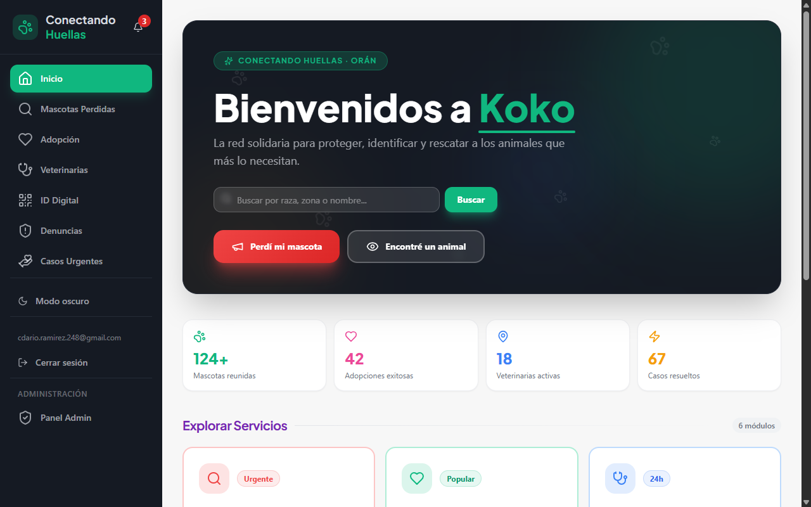
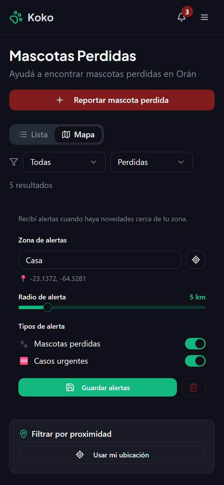
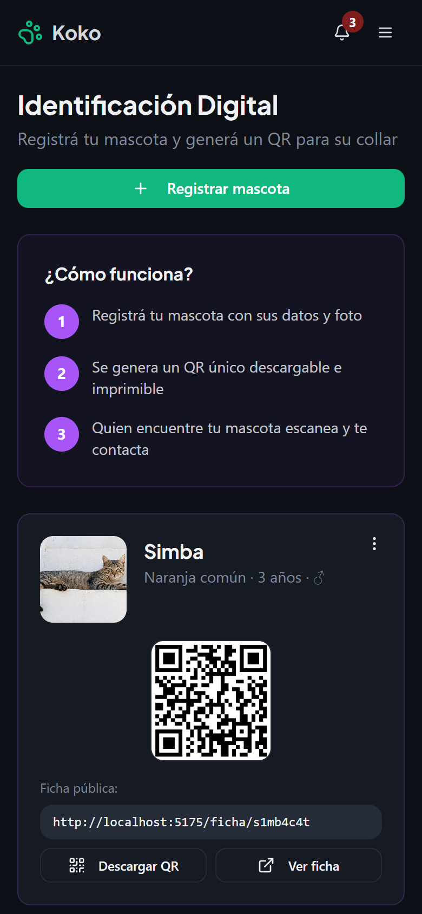
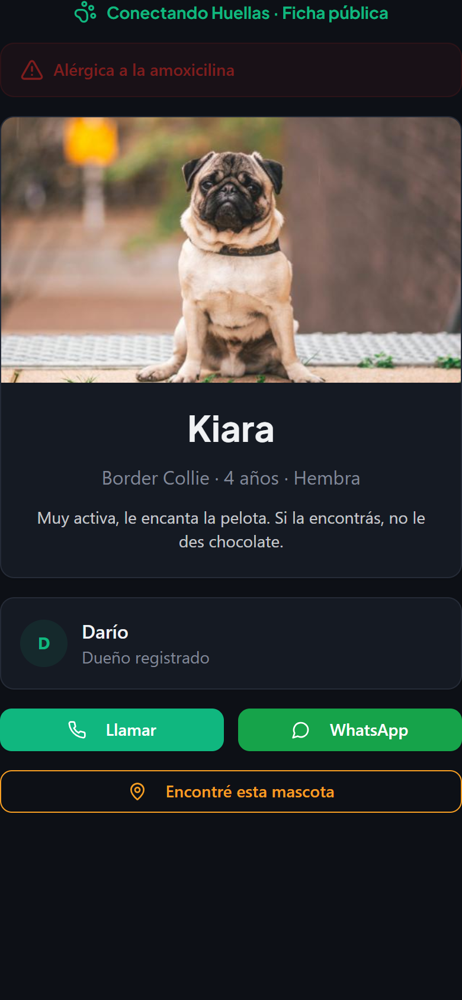

<p align="center">
  
</p>

<h1 align="center">Koko · Conectando Huellas</h1>

<p align="center">
  La comunidad mascotera de San Ramón de la Nueva Orán (Salta): mascotas perdidas, adopción,
  veterinarias de turno, chapita con QR, denuncias por maltrato y casos urgentes, en una sola app.
</p>

<p align="center">
  
  
  
  
  
</p>

<p align="center">
  
</p>

---

## Contenido

- [Por qué existe Koko](#por-qué-existe-koko)
- [Qué se puede hacer](#qué-se-puede-hacer)
- [Tecnologías](#tecnologías)
- [Puesta en marcha](#puesta-en-marcha)
- [Comandos](#comandos)
- [Estructura del proyecto](#estructura-del-proyecto)
- [Seguridad](#seguridad)
- [Supabase: panel, administración y base de datos](#supabase-panel-administración-y-base-de-datos)
- [App de Android (y iOS)](#app-de-android-y-ios)
- [Publicar la versión web](#publicar-la-versión-web)
- [Documentación del proyecto](#documentación-del-proyecto)
- [Estado y próximos pasos](#estado-y-próximos-pasos)
- [Equipo](#equipo)
- [Contribuir](#contribuir)

---

## Por qué existe Koko

En Orán, cuando se pierde una mascota, la búsqueda empieza en grupos de WhatsApp y
Facebook, carteles en los postes y el boca a boca. La información se dispersa, no se
puede buscar ni ubicar en un mapa, y desaparece del feed en pocas horas. Tampoco hay un
directorio confiable de veterinarias de guardia, las denuncias por maltrato no tienen
seguimiento y los rescatistas juntan fondos con cadenas de mensajes.

Koko reúne todo eso en una plataforma comunitaria pensada para usarse desde el celular. Se
desarrolló como proyecto final de **Prácticas Profesionalizantes III** del Instituto de
Enseñanza Superior N° 6.023 "Dr. Alfredo Loutaif", en el marco del convenio con la
**Fundación Rescatando Huellas**.

## Qué se puede hacer

| Módulo | Qué ofrece | ¿Sin cuenta? |
|---|---|---|
| **Mascotas perdidas** | Publicar con foto y ubicación, verlas en lista o en el mapa, filtrar por especie, estado, texto y cercanía. Cualquiera puede avisar "La vi" y el avistamiento aparece en el mapa. | Ver y avisar, sí |
| **Adopción** | Catálogo con filtros por especie y tamaño, datos sanitarios y chat con quien publica. | No |
| **Veterinarias** | Directorio verificado por administración, con quién está de turno según su horario, urgencias 24 h primero y contacto por WhatsApp. | Sí |
| **ID Digital** | Registrar tus mascotas y descargar su QR para la chapita. Quien lo escanea ve la ficha pública (con alergias destacadas) y puede avisarte que la encontró. | La ficha, sí |
| **Denuncias** | Urgentes, regulares o anónimas, con evidencia en fotos y videos y un código para seguir su estado. Marco legal: Ley 14.346. | No |
| **Casos urgentes** | Meta de recaudación, alias para transferir, lista de necesidades y chat. | Ver y colaborar, sí |

Además: chat por publicación (con aviso al dueño), campana de notificaciones, alertas por
zona, panel de administración (estadísticas, verificación de veterinarias y moderación),
modo claro y oscuro, y una vista de escritorio con menú fijo.

<p align="center">
  
  &nbsp;
  
  &nbsp;
  
</p>

## Tecnologías

| Capa | Herramientas |
|---|---|
| Interfaz | **Ionic 9 + Angular 21** (componentes standalone, signals, Reactive Forms, rutas con carga perezosa), Leaflet + OpenStreetMap, `qrcode` (el QR se genera en el dispositivo) |
| Backend | **Supabase**: PostgreSQL con seguridad a nivel de fila, Auth (email con código), Storage, Realtime y una Edge Function para Stripe. No hay servidor propio |
| Móvil | **Capacitor 8** para empaquetar la misma app como Android |
| Calidad | ESLint + angular-eslint (con reglas de accesibilidad), Vitest sobre jsdom, ramas y Pull Requests en GitHub |

La app empezó como un prototipo en Base44, se migró a Supabase con React y después se
reescribió en Ionic + Angular. La base de datos no cambió con la migración: toda la
seguridad vive en ella.

---

## Puesta en marcha

**No hace falta Docker ni la CLI de Supabase para desarrollar.** El equipo comparte un
único proyecto de Supabase en la nube: alcanza con las claves en un archivo local.

### 1. Clonar e instalar

Necesitás [Node.js](https://nodejs.org/) **22 LTS** (fijado en `.nvmrc`; con
[nvm-windows](https://github.com/coreybutler/nvm-windows) o nvm: `nvm install 22` y
`nvm use 22`). Angular 21 también acepta 20.19+ y 24.

```bash
git clone https://github.com/luanasegobia/koko-app.git
```

```bash
cd koko-app && npm install
```

### 2. Configurar las credenciales

```bash
cp .env.example .env.local
```

En Windows (PowerShell): `Copy-Item .env.example .env.local`

| Variable | ¿Obligatoria? | Para qué |
|---|---|---|
| `SUPABASE_URL` | Sí | Dirección del proyecto (ya viene completa en la plantilla). |
| `SUPABASE_ANON_KEY` | Sí | Clave **anon public** del panel: *Project Settings → API*. Si no tenés acceso, pedísela al equipo. |
| `STRIPE_PUBLISHABLE_KEY` | No | Activa el botón de donar con tarjeta. Vacía, el botón queda deshabilitado. |
| `HABILITAR_TIEMPO_REAL` | No | `true` para que chat y notificaciones lleguen en vivo. |
| `HABILITAR_ALERTAS` | No | `true` para generar alertas por cercanía (sondea cada 30 s). |
| `URL_PUBLICA` | No | Dirección de la versión web publicada, sin barra final. Se usa en el QR de cada mascota y en los correos de recuperación; vacía, se usa la dirección actual (en desarrollo, `localhost`). |

> [!WARNING]
> Usá siempre la clave **anon public**. La `service_role` (o una que empiece con
> `sb_secret_`) saltea todas las políticas de seguridad y, como el código del navegador es
> público, dejaría la base abierta para cualquiera. La app la rechaza si la pegás por error.

`.env.local` está en el `.gitignore` y nunca se sube. Angular no lee archivos `.env`:
`scripts/generar-entorno.mjs` lo convierte en `src/environments/entorno.local.ts` (también
ignorado) antes de cada `npm run dev`, `npm run build` y `npm test`. Si cambiás un valor,
reiniciá el servidor.

### 3. Levantar el servidor

```bash
npm run dev
```

Abrí <http://localhost:5175>. El puerto es fijo porque los correos de recuperación de
contraseña de Supabase apuntan a esa dirección. Si falta alguna clave, la app no queda en
blanco: muestra una pantalla que dice qué falta y cómo resolverlo.

---

## Comandos

| Comando | Qué hace |
|---|---|
| `npm run dev` | Servidor de desarrollo en `http://localhost:5175` |
| `npm test` | Tests unitarios con Vitest (13 archivos de prueba) |
| `npm run test:watch` | Tests en modo interactivo |
| `npm run lint` / `npm run lint:fix` | Revisa el código con ESLint / arregla lo que se pueda solo |
| `npm run build` | Compila para producción en `www/` |
| `npm run preview` | Sirve lo compilado, para probarlo |
| `npm run docs:pdf` | Exporta cada documento de `docs/` a PDF |

---

## Estructura del proyecto

```
src/
├── app/
│   ├── app.routes.ts           Mapa de rutas, con carga perezosa y guardias
│   ├── core/
│   │   ├── modelos.ts          Interfaces que reflejan las tablas de Supabase
│   │   ├── errores.ts          Errores tipados (configuración, datos, permisos, archivos)
│   │   ├── mensaje-de-error.ts Traduce cualquier error a una frase para la persona
│   │   ├── guardias/           autenticadoGuard y perfilCompletoGuard
│   │   └── servicios/          SupabaseService (todo acceso a datos), AuthService,
│   │                           NotificacionesService, TemaService, GestorChatService...
│   ├── layout/app-layout/      Menú lateral: fijo en escritorio, desplegable en el celular
│   ├── compartido/             Cabecera, mapa, chat, notificaciones, selector de foto...
│   └── paginas/                Una carpeta por pantalla: inicio, perdidas, adopcion,
│                               veterinarias, identificacion, denuncias, casos-urgentes,
│                               admin, ficha-publica, login, registro...
├── environments/               Validación de variables (entorno.local.ts se genera)
└── theme/variables.scss        Paleta de Koko sobre Ionic, en claro y oscuro
supabase/
├── migrations/                 Esquema de la base, un archivo por cambio
├── functions/                  Edge Function de pago con Stripe
└── seed_demo.sql               Datos de demostración
docs/                           Documentación académica, manual, presentación y video
scripts/                        Entorno, exportación de documentos y presentación, Android
```

Convenciones: páginas `nombre.page.ts`, componentes `nombre.component.ts`, servicios
`nombre.service.ts`; todo en español salvo los nombres de columna de la base. Las reglas
completas están en [`.agents/AGENTS.md`](.agents/AGENTS.md).

---

## Seguridad

La app usa la clave pública de Supabase desde el navegador, así que **la única barrera real
es la base de datos**:

- **RLS en todas las tablas.** Cada persona modifica solo lo suyo; administración, todo.
- **La autoría la pone el servidor** (`DEFAULT auth.uid()`), y un trigger fija el remitente
  de cada mensaje de chat: nadie publica ni escribe a nombre de otro.
- **Datos personales cerrados.** Las mascotas y las denuncias solo las lee su dueño. La ficha
  pública del QR y el listado de denuncias salen de funciones que devuelven solo lo
  necesario (`ficha_publica_mascota`, `denuncias_publicas`, `consultar_denuncia`).
- **Límites contra abusos** en lo que se puede hacer sin cuenta: avistamientos, mensajes de
  invitados y avisos al dueño.
- **`es_admin` no se puede escribir desde la app**, ni lo recaudado en un caso urgente.

El detalle está en la [Etapa 6 de la documentación](docs/06-diseno-base-de-datos.md).

---

## Supabase: panel, administración y base de datos

### Ajustes del panel

Estos ajustes **no viven en el repositorio**: se hacen una sola vez desde el panel.
(`supabase/config.toml` solo lo lee un stack local; el proyecto en la nube lo ignora.)

**Authentication → URL Configuration**

| Campo | Valor |
|---|---|
| Site URL | `http://localhost:5175` (o la dirección publicada) |
| Redirect URLs | `http://localhost:5175/**` y la dirección publicada con `/**` |

> [!IMPORTANT]
> El **Site URL** es el destino por defecto de los correos de autenticación. El día que se
> publique la app hay que cambiarlo por la dirección real, o los correos van a mandar a cada
> persona a su propia máquina.

**Login con Google (opcional, todavía no habilitado):** *Authentication → Providers →
Google*, cargar el Client ID y el Client Secret de Google Cloud y registrar allá la URL de
retorno que muestra el panel. Mientras tanto, el botón "Continuar con Google" da error; el
acceso con email y contraseña funciona igual.

### Convertirse en administrador

El panel `/admin` requiere la marca `es_admin`, que por seguridad **no se puede escribir
desde la aplicación**. Se otorga desde el SQL Editor del panel:

```sql
update public.profiles p
   set es_admin = true
  from auth.users u
 where u.id = p.id
   and u.email = 'poner.aca@tu.email';
```

Para ver quién es admin:

```sql
select u.email, p.tipo_cuenta, p.es_admin, p.profile_completed
  from public.profiles p
  join auth.users u on u.id = p.id
 order by p.created_at desc;
```

Después, **cerrá sesión y volvé a entrar**: el permiso se lee al iniciar sesión.

### Cambiar el esquema

El proyecto compartido ya tiene todas las migraciones aplicadas; para desarrollar no hace
falta tocar nada. Solo si vas a modificar el esquema:

1. Instalá la [CLI de Supabase](https://supabase.com/docs/guides/local-development).
2. Enlazá el repo con el proyecto (una sola vez):
   ```bash
   supabase link --project-ref knvocftylpunbzycoarx
   ```
3. Creá un archivo nuevo en `supabase/migrations/` (nunca edites uno existente) y aplicalo:
   ```bash
   supabase db push
   ```

> [!CAUTION]
> La base de desarrollo es compartida entre las tres personas del equipo. Una migración la
> aplica una sola persona y avisa al resto; los cambios destructivos se conversan antes.

### Datos de demostración

`supabase/seed_demo.sql` carga cuentas ficticias y publicaciones de ejemplo en Orán
(mascotas perdidas con avistamientos, adopciones, veterinarias, casos urgentes, denuncias,
fichas QR y un chat). Se pega en el SQL Editor y es re-ejecutable. Las cuentas y su
contraseña están en el encabezado del archivo.

---

## App de Android (y iOS)

La misma app se empaqueta con [Capacitor](https://capacitorjs.com/). Para Android hace
falta Android Studio:

```bash
npm run build
```

```bash
npx cap add android
```

```bash
powershell -ExecutionPolicy Bypass -File scripts/preparar-android.ps1
```

```bash
npx cap open android
```

`preparar-android.ps1` genera los íconos desde el logo y agrega los permisos de ubicación
(sin ellos, "Usar mi ubicación" falla dentro de la app). Cada vez que cambie el código web:
`npm run build && npx cap sync`.

- La carpeta `android/` se genera en cada máquina y no se sube al repositorio.
- En Android Studio hay que abrir **`android`**, no la raíz del proyecto.
- Si la ruta tiene espacios, `npx cap run android` no encuentra `gradlew`: compilá con el
  botón Run de Android Studio.
- Para que el QR abra en el celular de quien lo escanea, cargá `URL_PUBLICA` antes de
  compilar.

**iOS:** Capacitor también genera el proyecto de iOS (`npm install @capacitor/ios` y
`npx cap add ios`), pero se compila en una Mac con Xcode, y para publicar hace falta una
cuenta de Apple Developer.

---

## Publicar la versión web

`npm run build` deja una aplicación estática en `www/browser`. Cualquier hosting estático
sirve; `public/vercel.json` ya trae la regla para Vercel que redirige todas las rutas a
`index.html` (sin ella, recargar `/perdidas` da 404).

Al publicar:

1. Cargá `URL_PUBLICA` con la dirección real, para que los QR y los correos apunten ahí.
2. En Supabase, cambiá el **Site URL** y sumá la dirección a **Redirect URLs**.
3. La política de privacidad queda en `/privacidad.html` (`public/privacidad.html`).

---

## Documentación del proyecto

La documentación académica de Prácticas Profesionalizantes III está en [`docs/`](docs/README.md),
un Markdown por etapa:

| Documento | Contenido |
|---|---|
| [Análisis del problema](docs/01-analisis-del-problema.md) | Contexto, usuarios, objetivos y alcance |
| [Requisitos](docs/02-requisitos.md) | Funcionales, no funcionales y de datos, con su estado real |
| [Casos de uso](docs/03-casos-de-uso.md) | Actores, diagramas y especificaciones |
| [Diagramas UML](docs/04-diagramas-uml.md) | Componentes, clases, secuencia, flujo y estados |
| [Planificación RUP](docs/05-planificacion-rup.md) | Fases, cronograma y riesgos |
| [Diseño de base de datos](docs/06-diseno-base-de-datos.md) | Diagrama entidad-relación, diccionario de datos, funciones y RLS |
| [Manual de usuario](docs/07-manual-de-usuario.md) | Guía paso a paso con capturas |
| [Presentación](docs/08-presentacion.md) | Guion de la defensa |
| [Glosario](docs/09-glosario.md) | Términos, siglas y abreviaturas |

Los PDF se generan con `npm run docs:pdf` (ver [`docs/README.md`](docs/README.md)).

---

## Estado y próximos pasos

Los seis módulos funcionan de punta a punta. Lo que queda, documentado como "parcial" o
"pendiente" en la [Etapa 2](docs/02-requisitos.md):

- **Donaciones con tarjeta (Stripe):** la función de pago está lista; falta cargar las
  claves y el webhook que actualice lo recaudado. Mientras tanto, se dona por alias.
- **Tiempo real:** la base ya publica los cambios; se enciende con `HABILITAR_TIEMPO_REAL`.
- **Alertas por cercanía:** implementadas, apagadas por defecto (`HABILITAR_ALERTAS`).
- Que el dueño marque su mascota como encontrada y cambie el estado de una adopción.
- Login con Google y publicación en Google Play.

---

## Equipo

Proyecto de **Prácticas Profesionalizantes III** · Tecnicatura Superior en Análisis de
Sistemas y Desarrollo de Software · Instituto de Enseñanza Superior N° 6.023
"Dr. Alfredo Loutaif", San Ramón de la Nueva Orán, Salta · 2026.

- Carina Abigail Ledesma
- Cristian Darío Ramírez
- Luana Victoria Segobia

Con la colaboración de la **Fundación Rescatando Huellas** (contra el maltrato y abandono
animal).

---

## Contribuir

Leé [CONTRIBUTING.md](CONTRIBUTING.md) antes del primer Pull Request. En resumen: nunca se
commitea directo a `main`, las ramas y los commits van en español, y antes de abrir un PR
se corre `npm run lint`, `npm test` y `npm run build`.
