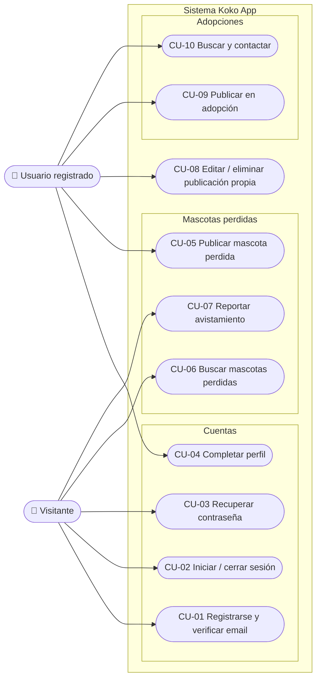
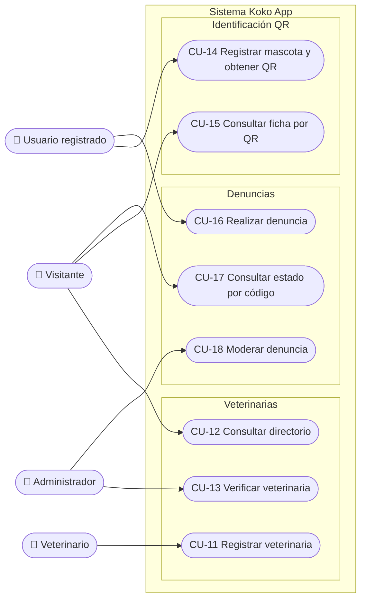
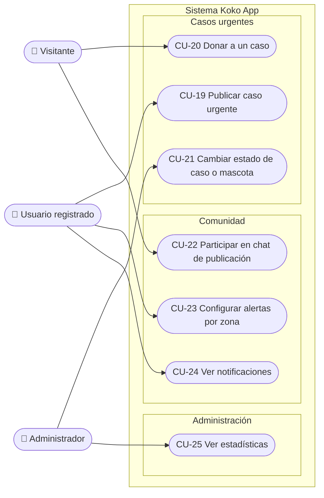

# Etapa 3 — Casos de uso

**Proyecto:** Koko App · Conectando Huellas

**Documento:** 3 de 8 · Actores, diagrama y especificación de casos de uso

---

## 1. Actores

| Actor | Descripción | Hereda de |
|---|---|---|
| **Visitante** | Persona sin sesión iniciada. Puede consultar la información pública, reportar avistamientos, participar del chat rápido con un nombre, consultar denuncias por código y ver fichas QR. | — |
| **Usuario registrado** | Persona con cuenta y perfil completo. Puede publicar en todos los módulos, gestionar sus propias publicaciones, chatear y recibir alertas. Su tipo de cuenta (usuario común, rescatista, organización) es informativo. | Visitante |
| **Veterinario** | Usuario registrado que eligió el tipo de cuenta "veterinario" y registró su clínica. Puede editar su ficha del directorio. | Usuario registrado |
| **Administrador** | Usuario registrado con la marca de administrador. Verifica veterinarias, modera denuncias, cambia estados y puede editar o eliminar cualquier publicación. | Usuario registrado |
| **Supabase (sistema externo)** | Plataforma de autenticación, base de datos y archivos. Envía los emails de verificación y recuperación, y ejecuta las reglas de seguridad. | — |
| **Stripe (sistema externo)** | Pasarela de pago para donaciones con tarjeta. Fuera del alcance de esta entrega. | — |

## 2. Lista de casos de uso

| ID | Caso de uso | Actor principal | Módulo | Requisitos |
|---|---|---|---|---|
| CU-01 | Registrarse y verificar el email | Visitante | Cuentas | RF-01 |
| CU-02 | Iniciar sesión / cerrar sesión | Visitante, Usuario registrado | Cuentas | RF-02 |
| CU-03 | Recuperar contraseña | Visitante | Cuentas | RF-03 |
| CU-04 | Completar el perfil y elegir tipo de cuenta | Usuario registrado | Cuentas | RF-04 |
| CU-05 | Publicar mascota perdida | Usuario registrado | Perdidas | RF-07 |
| CU-06 | Buscar mascotas perdidas (lista, mapa y filtros) | Visitante | Perdidas | RF-08, RF-09 |
| CU-07 | Reportar avistamiento | Visitante | Perdidas | RF-10 |
| CU-08 | Editar o eliminar una publicación propia | Usuario registrado | Transversal | RF-11 |
| CU-09 | Publicar animal en adopción | Usuario registrado | Adopción | RF-14 |
| CU-10 | Buscar animales en adopción y contactar | Usuario registrado | Adopción | RF-15, RF-16 |
| CU-11 | Registrar veterinaria | Veterinario | Veterinarias | RF-18 |
| CU-12 | Consultar directorio de veterinarias | Visitante | Veterinarias | RF-19, RF-20, RF-21 |
| CU-13 | Verificar veterinaria | Administrador | Veterinarias | RF-22 |
| CU-14 | Registrar mascota y obtener QR | Usuario registrado | Identificación | RF-24, RF-25, RF-27 |
| CU-15 | Consultar ficha pública por QR | Visitante | Identificación | RF-26 |
| CU-16 | Realizar denuncia por maltrato | Usuario registrado | Denuncias | RF-29, RF-30 |
| CU-17 | Consultar estado de denuncia por código | Visitante | Denuncias | RF-31 |
| CU-18 | Moderar denuncia (cambiar estado) | Administrador | Denuncias | RF-33 |
| CU-19 | Publicar caso urgente | Usuario registrado | Casos urgentes | RF-36 |
| CU-20 | Donar a un caso urgente | Visitante | Casos urgentes | RF-38, RF-39 |
| CU-21 | Cambiar estado de caso urgente o mascota perdida | Administrador | Administración | RF-12, RF-40 |
| CU-22 | Participar en el chat de una publicación | Visitante, Usuario registrado | Comunidad | RF-42, RF-43 |
| CU-23 | Configurar alertas por zona | Usuario registrado | Comunidad | RF-45 |
| CU-24 | Ver notificaciones | Usuario registrado | Comunidad | RF-47 |
| CU-25 | Ver estadísticas de la plataforma | Administrador | Administración | RF-49 |

## 3. Diagrama de casos de uso

El sistema se presenta en tres vistas, agrupando los módulos de a tres para que cada
diagrama entre en una página legible. En todas, los actores están a la izquierda y el
recuadro "Sistema Koko App" delimita los casos de uso. Los actores Usuario registrado,
Veterinario y Administrador **heredan** las capacidades del Visitante (sección 1), por
lo que no se repiten sus flechas.

### 3.1 Cuentas, mascotas perdidas y adopciones

### 3.2 Veterinarias, identificación QR y denuncias

### 3.3 Casos urgentes, comunidad y administración

### 3.4 Relaciones entre casos de uso

| Relación | Casos | Explicación |
|---|---|---|
| `include` | CU-11 Registrar veterinaria → CU-04 Completar perfil | El alta de la veterinaria ocurre dentro del paso de completar el perfil al elegir el tipo de cuenta "veterinario". |
| `include` | CU-01 Registrarse y CU-03 Recuperar contraseña → Supabase | El envío del código de verificación y del enlace de recuperación lo realiza el sistema externo de autenticación. |
| `include` | CU-24 Ver notificaciones → CU-22 Chat | Las notificaciones de respuesta se generan a partir de los mensajes del chat de una publicación. |
| `extend` | CU-07 Reportar avistamiento → CU-06 Buscar mascotas perdidas | Reportar un avistamiento amplía la consulta de una mascota perdida; no siempre ocurre. |
| `extend` | CU-22 Chat → CU-06 Buscar mascotas perdidas, CU-10 Buscar y contactar, CU-19 Casos urgentes | El chat es opcional dentro de cada publicación. |
| `extend` | CU-20 Donar → Stripe | La donación con tarjeta amplía la donación por alias cuando la pasarela está habilitada. |
| Generalización | Usuario registrado, Veterinario, Administrador → Visitante | Todo lo que puede hacer un visitante lo puede hacer cualquier actor con sesión. |

## 4. Especificación detallada

Se detallan los ocho casos de uso más representativos, uno por módulo más los de
moderación. El resto sigue la misma plantilla y se resume en la tabla de la sección 2.

---

### CU-05 · Publicar mascota perdida

| | |
|---|---|
| **Actor principal** | Usuario registrado |
| **Actores secundarios** | Supabase (almacenamiento de la foto) |
| **Descripción** | El dueño publica el aviso de su mascota perdida con foto, descripción, lugar donde fue vista por última vez y contacto, para que aparezca en la lista y el mapa públicos. |
| **Precondiciones** | Sesión iniciada y perfil completo. |
| **Postcondiciones** | Existe una publicación con estado *perdida*, atribuida al usuario, visible para todo el mundo. |
| **Requisitos** | RF-07, RNF-02, RNF-11 |

**Flujo principal**

1. El usuario entra a *Mascotas perdidas* (o toca "Perdí mi mascota" en el inicio) y
   presiona **"Reportar mascota perdida"**.
2. El sistema muestra el formulario.
3. El usuario ingresa nombre, especie, y opcionalmente raza, edad y descripción.
4. El usuario toca **"Sacar foto"**; el sistema abre la cámara del celular y muestra la
   vista previa.
5. El usuario escribe la dirección donde la vio por última vez y toca **"Usar mi
   ubicación"**; el sistema pide permiso de GPS y guarda las coordenadas.
6. El usuario ingresa teléfono y WhatsApp de contacto y presiona **"Publicar"**.
7. El sistema valida los datos, sube la foto al almacenamiento, guarda la publicación
   con estado *perdida* y autor igual al usuario.
8. El sistema cierra el formulario y muestra la nueva publicación al principio de la
   lista.

**Flujos alternativos**

- **1a. Sin sesión.** El sistema redirige a la pantalla de inicio de sesión y, tras
  entrar, vuelve a *Mascotas perdidas*.
- **3a. Falta el nombre.** El sistema marca el campo con "El nombre es obligatorio" y no
  envía.
- **4a. Sin cámara o el usuario cancela.** La publicación se crea sin foto.
- **5a. Permiso de ubicación denegado.** El sistema informa "No nos diste permiso para
  acceder a tu ubicación. Podés escribir la dirección a mano" y continúa sin
  coordenadas; la publicación aparece en la lista pero no en el mapa.
- **7a. Falla la subida de la foto o la conexión.** El sistema muestra el error dentro
  del formulario, conserva lo escrito y habilita el botón para reintentar.

---

### CU-07 · Reportar avistamiento

| | |
|---|---|
| **Actor principal** | Visitante (también Usuario registrado) |
| **Descripción** | Alguien que vio una mascota publicada como perdida avisa dónde y cuándo la vio, sin necesidad de tener cuenta. |
| **Precondiciones** | Existe una publicación de mascota perdida. |
| **Postcondiciones** | La publicación tiene un avistamiento más, con fecha y, si se indicó, coordenadas visibles en el mapa. |
| **Requisitos** | RF-10, RN-04 |

**Flujo principal**

1. El visitante encuentra la mascota en la lista o el mapa y toca **"La vi"**.
2. El sistema abre el diálogo de avistamiento.
3. El visitante escribe dónde la vio y, opcionalmente, una nota.
4. El visitante toca **"Usar mi ubicación"** y el sistema guarda las coordenadas.
5. El visitante presiona **"Enviar"**.
6. El sistema valida en el servidor (lugar obligatorio y de hasta 200 caracteres, nota de
   hasta 500, coordenadas completas y en rango, menos de 50 avistamientos) y agrega el
   avistamiento a la publicación con la fecha actual.
7. El sistema muestra "¡Gracias por tu avistamiento!", cierra el diálogo y actualiza la
   lista y el mapa con el nuevo marcador.

**Flujos alternativos**

- **3a. Lugar vacío.** El navegador impide enviar hasta completarlo.
- **4a. Sin permiso de GPS.** El avistamiento se guarda solo con la dirección escrita y
  no aparece como marcador en el mapa.
- **6a. La publicación ya tiene 50 avistamientos.** El sistema informa "Esta publicación
  ya alcanzó el máximo de avistamientos".
- **6b. La publicación fue eliminada mientras tanto.** El sistema informa "No encontramos
  esa publicación".
- **6c. Sin conexión.** El sistema muestra el error en el diálogo y permite reintentar.

---

### CU-09 · Publicar animal en adopción

| | |
|---|---|
| **Actor principal** | Usuario registrado (típicamente rescatista u organización) |
| **Actores secundarios** | Supabase (almacenamiento de la foto) |
| **Descripción** | Un usuario ofrece un animal en adopción con sus datos, estado sanitario y contacto. |
| **Precondiciones** | Sesión iniciada y perfil completo. |
| **Postcondiciones** | Existe una publicación con estado *disponible* atribuida al usuario, visible para los usuarios registrados. |
| **Requisitos** | RF-14 |

**Flujo principal**

1. El usuario entra a *Adopción* y presiona **"Publicar en adopción"**.
2. El sistema muestra el formulario.
3. El usuario ingresa nombre, especie, sexo, tamaño, y opcionalmente raza, edad y
   descripción.
4. El usuario marca si el animal está vacunado y esterilizado.
5. El usuario elige una foto, ingresa su nombre, teléfono y barrio, y presiona
   **"Publicar"**.
6. El sistema valida, sube la foto, guarda la publicación con estado *disponible* y la
   muestra en el catálogo.

**Flujos alternativos**

- **1a. Sin sesión o perfil incompleto.** El sistema redirige a iniciar sesión o a
  completar el perfil, respectivamente, y luego vuelve a *Adopción*.
- **3a. Falta el nombre.** El sistema marca el campo y no envía.
- **6a. Error de subida o de red.** El sistema muestra el error y conserva el
  formulario.

---

### CU-13 · Verificar veterinaria

| | |
|---|---|
| **Actor principal** | Administrador |
| **Actores secundarios** | Veterinario (registró la ficha en CU-11) |
| **Descripción** | El administrador revisa una veterinaria registrada y la aprueba para que aparezca en el directorio público, o le revoca la verificación. |
| **Precondiciones** | Sesión con marca de administrador. Existe al menos una veterinaria registrada. |
| **Postcondiciones** | La veterinaria queda marcada como verificada (o no) y el directorio público refleja el cambio. |
| **Requisitos** | RF-18, RF-19, RF-22, RN-01 |

**Flujo principal**

1. Un profesional se registra, elige el tipo de cuenta **"Veterinario / Clínica"** y
   completa nombre de la clínica, dirección, teléfono, servicios y descripción (CU-11).
   El sistema guarda la ficha como *no verificada* y le avisa que será revisada.
2. El administrador entra a **Panel Admin → Veterinarias**; el sistema muestra la
   pestaña *Pendientes* con la cantidad a revisar.
3. El administrador lee la ficha (nombre, dirección, teléfono, descripción, servicios,
   fecha de registro) y contrasta la información por fuera del sistema.
4. El administrador presiona **"Aprobar"**.
5. El sistema marca la veterinaria como verificada y la mueve a la pestaña
   *Verificadas*.
6. A partir de ese momento la ficha aparece en el directorio y el mapa públicos.

**Flujos alternativos**

- **1a. Intento de registrarse ya verificada.** La base de datos rechaza cualquier alta
  con la marca de verificación activa, aunque se manipule la aplicación.
- **2a. Usuario sin marca de administrador.** El sistema muestra "Acceso restringido" y
  el enlace al panel no aparece en el menú.
- **4a. La ficha no corresponde.** El administrador no aprueba; la ficha queda pendiente
  y puede eliminarla desde el directorio (solo administración puede borrar
  veterinarias).
- **5a. Revocar.** Sobre una veterinaria verificada, el administrador presiona
  **"Revocar"** y la ficha desaparece del directorio público.

---

### CU-14 · Registrar mascota y obtener QR

| | |
|---|---|
| **Actor principal** | Usuario registrado (dueño) |
| **Descripción** | El dueño registra los datos de su mascota y obtiene un código QR para imprimir en una chapa; quien lo escanee verá la ficha pública (CU-15). |
| **Precondiciones** | Sesión iniciada y perfil completo. |
| **Postcondiciones** | Existe una mascota con código QR único atribuida al usuario, y un archivo PNG con el QR descargado en el dispositivo. |
| **Requisitos** | RF-24, RF-25, RF-27, RNF-05, RN-03 |

**Flujo principal**

1. El usuario entra a *Identificación* y presiona **"Registrar mascota"**.
2. El sistema muestra el formulario.
3. El usuario ingresa nombre, especie, sexo, y opcionalmente raza, edad, descripción,
   alergias, foto, y su nombre, teléfono y WhatsApp.
4. El usuario presiona **"Guardar"**.
5. El sistema genera un código único de 8 caracteres, sube la foto y guarda la mascota.
6. El sistema muestra la tarjeta de la mascota con el QR generado en el propio
   dispositivo, la dirección pública de la ficha y los botones **"Descargar QR"** y
   **"Ver ficha"**.
7. El usuario toca **"Descargar QR"** y obtiene un PNG para imprimir.

**Flujos alternativos**

- **3a. Falta el nombre.** El sistema marca el campo y no envía.
- **5a. El código generado ya existe (colisión).** La base de datos rechaza el alta con
  "Ese registro ya existe" y el usuario reintenta.
- **6a. Edición posterior.** Si el usuario edita la mascota, el sistema conserva el
  código QR original, porque puede haber chapas ya impresas.

---

### CU-15 · Consultar ficha pública por QR

| | |
|---|---|
| **Actor principal** | Visitante (quien encontró la mascota) |
| **Descripción** | Una persona escanea la chapa de una mascota y ve sus datos y cómo contactar al dueño. |
| **Precondiciones** | La mascota fue registrada (CU-14) y el QR está impreso o visible. |
| **Postcondiciones** | Ninguna en el sistema; el contacto se hace por teléfono o WhatsApp. |
| **Requisitos** | RF-26, RF-28 |

**Flujo principal**

1. El visitante escanea el QR con la cámara del celular.
2. El navegador abre la dirección pública de la ficha.
3. El sistema busca la mascota por su código.
4. El sistema muestra la ficha: alergias destacadas en rojo si las hay, foto, nombre,
   raza, edad, sexo, descripción y tarjeta del dueño.
5. El visitante toca **"Llamar"** o **"WhatsApp"** y el celular abre la llamada o el
   chat con el dueño.

**Flujos alternativos**

- **3a. El código no corresponde a ninguna mascota.** El sistema muestra "Mascota no
  encontrada. El código QR no corresponde a ninguna mascota registrada".
- **5a. El dueño no cargó teléfono ni WhatsApp.** Los botones de contacto no se muestran.
- **5b. Botón "Encontré esta mascota".** En esta versión muestra la confirmación pero no
  envía notificación al dueño (RF-28 pendiente).

---

### CU-16 · Realizar denuncia por maltrato

| | |
|---|---|
| **Actor principal** | Usuario registrado |
| **Actores secundarios** | Supabase (almacenamiento de evidencia y generación del código) |
| **Descripción** | Un usuario denuncia una situación de maltrato animal, adjunta evidencia y recibe un código para hacer seguimiento. |
| **Precondiciones** | Sesión iniciada y perfil completo. |
| **Postcondiciones** | Existe una denuncia en estado *pendiente* con código de seguimiento único, visible para administración y consultable por código. |
| **Requisitos** | RF-29, RF-30, RF-34, RN-02, RN-03 |

**Flujo principal**

1. El usuario entra a *Denuncias* y presiona **"Reportar"**.
2. El sistema muestra el formulario con las pestañas *Urgente*, *Regular* y *Anónima*.
3. El usuario elige el tipo y describe la situación.
4. El usuario escribe la dirección y toca **"Usar mi ubicación"** para agregar
   coordenadas.
5. El usuario adjunta fotos o videos como evidencia.
6. Si la denuncia no es anónima, el usuario ingresa su nombre y teléfono.
7. El usuario presiona **"Enviar denuncia"**.
8. El sistema sube cada archivo de evidencia, guarda la denuncia con estado
   *pendiente* y la base de datos genera un código de seguimiento único de 8 caracteres.
9. El sistema muestra el código en grande con un botón para copiarlo y la leyenda
   "Guardá este código para consultar el estado de tu denuncia".

**Flujos alternativos**

- **3a. Descripción vacía.** El sistema marca "La descripción es obligatoria".
- **3b. Tipo anónima.** El sistema oculta los campos de nombre y teléfono y no los
  guarda; la denuncia igual queda asociada internamente a la cuenta para poder
  moderarla.
- **5a. Archivo de más de 25 MB o de un tipo no permitido.** El sistema informa el
  problema y no envía.
- **8a. Falla la subida de un archivo o la red.** El sistema muestra el error y conserva
  el formulario.
- **Post. Eliminar la denuncia.** El denunciante no puede borrarla (para no eliminar
  evidencia); solo el administrador.

---

### CU-18 · Moderar denuncia

| | |
|---|---|
| **Actor principal** | Administrador |
| **Descripción** | El administrador revisa las denuncias recibidas, ve la evidencia y actualiza su estado a medida que las gestiona o deriva a las autoridades. |
| **Precondiciones** | Sesión con marca de administrador. Existe al menos una denuncia. |
| **Postcondiciones** | La denuncia queda en el nuevo estado, que el denunciante puede consultar con su código (CU-17). |
| **Requisitos** | RF-33, RF-34, RF-49 |

**Flujo principal**

1. El administrador entra a **Panel Admin → Casos & Reportes → Denuncias**; el sistema
   muestra la cantidad de denuncias pendientes.
2. El sistema lista cada denuncia con estado, tipo, código, descripción, dirección,
   datos del denunciante (si no es anónima), fecha y miniaturas de la evidencia.
3. El administrador abre la evidencia para evaluarla.
4. El administrador cambia el estado en el desplegable: *pendiente* → *en revisión* →
   *derivada* o *resuelta*.
5. El sistema guarda el nuevo estado y actualiza la lista.
6. El denunciante consulta el estado con su código y ve el cambio.

**Flujos alternativos**

- **1a. Usuario sin marca de administrador.** El sistema muestra "Acceso restringido".
- **4a. Denuncia falsa o duplicada.** El administrador la elimina desde el módulo de
  denuncias (menú ⋯ → Eliminar), previa confirmación "Esta acción no se puede deshacer".
- **5a. Sin conexión.** El sistema informa el error y el desplegable vuelve al estado
  anterior.

---

### CU-19 · Publicar caso urgente

| | |
|---|---|
| **Actor principal** | Usuario registrado (típicamente rescatista u organización) |
| **Actores secundarios** | Supabase (almacenamiento de la foto) |
| **Descripción** | Un rescatista publica un caso que necesita colaboración económica o de insumos, con meta, alias bancario y lista de necesidades. |
| **Precondiciones** | Sesión iniciada y perfil completo. |
| **Postcondiciones** | Existe un caso con estado *activo*, recaudación en cero, visible para todo el mundo con su alias para donar. |
| **Requisitos** | RF-36, RF-37, RF-38 |

**Flujo principal**

1. El usuario entra a *Casos urgentes* y presiona **"Publicar nuevo caso"**.
2. El sistema muestra el formulario.
3. El usuario ingresa título, descripción, quién publica, meta económica y alias
   bancario.
4. El usuario agrega las necesidades una por una (por ejemplo "Cirugía", "Alimento
   balanceado") con **"+ Agregar"**.
5. El usuario elige una foto y presiona **"Publicar"**.
6. El sistema valida, sube la foto y guarda el caso con estado *activo*, recaudado $0 y
   cada necesidad en estado *pendiente*.
7. El sistema muestra el caso en la lista con barra de progreso, alias con botón
   **"Copiar"** y la lista de necesidades.

**Flujos alternativos**

- **1a. Sin sesión.** El sistema redirige a iniciar sesión.
- **3a. Falta título o descripción.** El sistema marca el campo obligatorio.
- **6a. Error de red o subida.** El sistema muestra el error y conserva el formulario.
- **7a. Donación por alias.** Un visitante copia el alias y transfiere por fuera de la
  app; el monto recaudado se actualiza manualmente por administración (RF-39 parcial).
- **7b. Cierre del caso.** Cuando se cubre, el administrador lo pasa a *resuelto*
  (CU-21).

---

## 5. Trazabilidad requisitos ↔ casos de uso

| Módulo | Casos de uso | Requisitos funcionales cubiertos |
|---|---|---|
| Cuentas | CU-01 a CU-04 | RF-01 a RF-06 |
| Mascotas perdidas | CU-05, CU-06, CU-07, CU-08, CU-21 | RF-07 a RF-13 |
| Adopciones | CU-09, CU-10, CU-08 | RF-14 a RF-17 |
| Veterinarias | CU-11, CU-12, CU-13 | RF-18 a RF-23 |
| Identificación QR | CU-14, CU-15 | RF-24 a RF-28 |
| Denuncias | CU-16, CU-17, CU-18 | RF-29 a RF-35 |
| Casos urgentes | CU-19, CU-20, CU-21 | RF-36 a RF-41 |
| Comunidad | CU-22, CU-23, CU-24 | RF-42 a RF-48 |
| Administración | CU-13, CU-18, CU-21, CU-25 | RF-49 a RF-51 |
