# Etapa 4 — Diagramas UML

**Proyecto:** Koko App · Conectando Huellas

**Documento:** 4 de 8 · Diagramas de clases, de secuencia, de flujo y de estados

---

## 1. Convenciones

- Los diagramas están escritos en Mermaid dentro de este documento y se renderizan al
  generar el PDF. El texto fuente es la versión oficial: si cambia el código, se corrige
  acá y se vuelve a exportar.
- Las clases del dominio llevan nombre en español (`MascotaPerdida`) y, entre paréntesis
  en el diccionario, la tabla de PostgreSQL que las persiste (`lost_pet`). Los atributos
  conservan el nombre de columna para que el diagrama sirva como referencia directa de la
  Etapa 6.
- Cada diagrama indica los casos de uso (CU-xx) y requisitos (RF-xx) que ilustra.

## 2. Diagrama de componentes: arquitectura general

Antes de las clases conviene ver cómo se reparte el sistema. Koko es una aplicación de
una sola página (SPA) en React que habla con Supabase; no hay servidor propio. La lógica
que necesita privilegios vive en la base de datos como funciones y triggers.

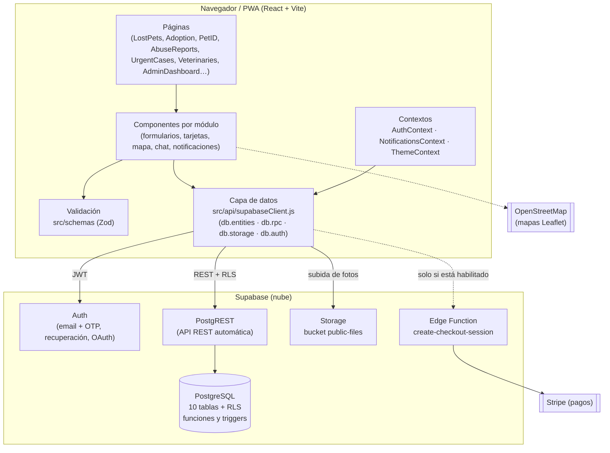

**Lectura.** La interfaz nunca accede a la base de datos con privilegios: usa la clave
pública y cada consulta pasa por las políticas de seguridad a nivel de fila (RLS). Lo que
requiere permisos especiales (crear notificaciones para otra persona, agregar
avistamientos a una publicación ajena, generar códigos únicos) se resuelve con funciones
`SECURITY DEFINER` y triggers dentro de PostgreSQL.

## 3. Diagramas de clases

Modelo de dominio: qué objetos maneja el sistema, con sus atributos y relaciones. Se
presenta en tres vistas para que cada una sea legible.

### 3.1 Perfil y mascotas

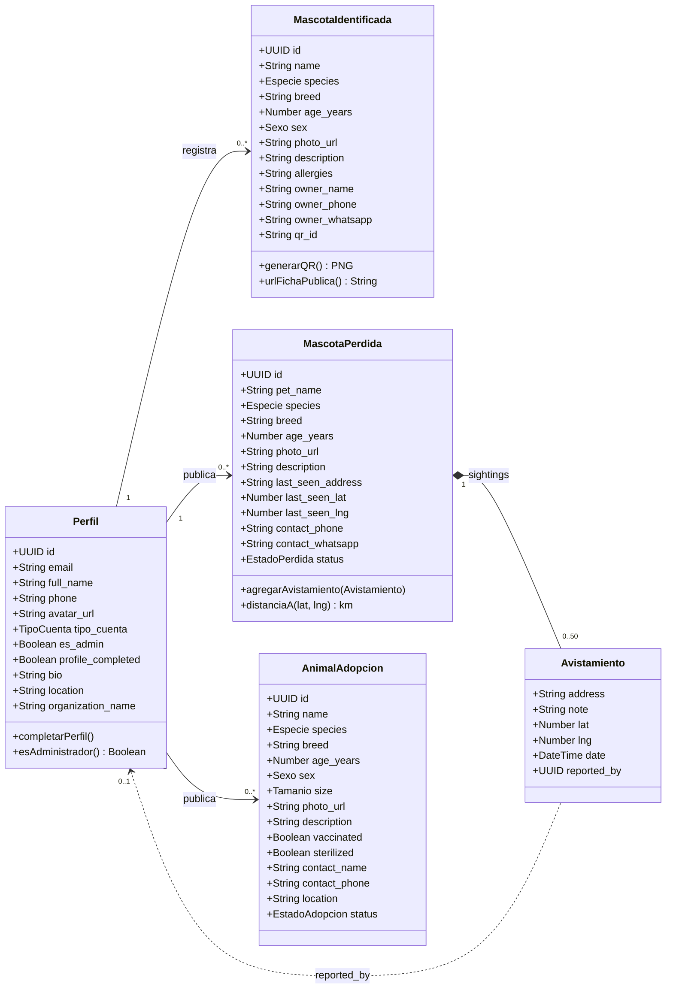

### 3.2 Veterinarias, casos urgentes y denuncias

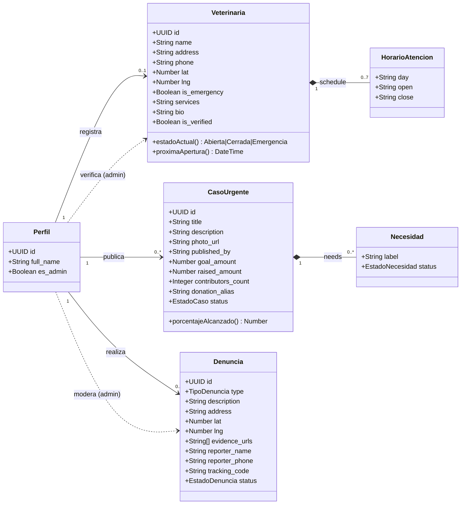

### 3.3 Comunidad: chat, notificaciones y alertas

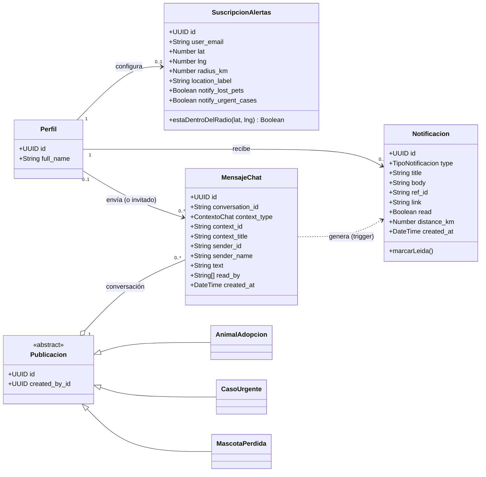

### 3.4 Enumeraciones

Los atributos de tipo enumerado que aparecen en los diagramas toman estos valores
(coinciden con las restricciones `CHECK` de la base de datos).

| Enumeración | Valores | Usada en |
|---|---|---|
| Especie | perro, gato, otro | MascotaIdentificada, MascotaPerdida, AnimalAdopcion |
| Sexo | macho, hembra | MascotaIdentificada, AnimalAdopcion |
| Tamanio | pequeño, mediano, grande | AnimalAdopcion |
| TipoCuenta | usuario, rescatista, organizacion, veterinario | Perfil |
| EstadoPerdida | perdida, encontrada | MascotaPerdida |
| EstadoAdopcion | disponible, en_proceso, adoptado | AnimalAdopcion |
| EstadoCaso | activo, en_curso, resuelto | CasoUrgente |
| EstadoNecesidad | pendiente, parcial, cubierto | Necesidad |
| TipoDenuncia | urgente, regular, anonima | Denuncia |
| EstadoDenuncia | pendiente, en_revision, derivada, resuelta | Denuncia |
| ContextoChat | lost_pet, urgent_case, adoption | MensajeChat |
| TipoNotificacion | lost_pet, urgent_case, sighting, abuse_report, chat_reply, case_update | Notificacion |

**Notas de diseño.**

- `Avistamiento`, `HorarioAtencion` y `Necesidad` no son tablas propias: se guardan como
  arreglos JSON dentro de su publicación (composición fuerte, rombo negro). La Etapa 6
  justifica la decisión.
- `Publicacion` es una abstracción del modelo: en la base no existe una tabla común, pero
  las tres tablas comparten `created_by_id`, `created_at`, `updated_at` y el mismo
  esquema de permisos, y el chat las trata de forma uniforme.
- El emisor de un mensaje puede ser un perfil o un invitado sin cuenta; por eso
  `sender_id` es texto y no una clave foránea.

## 4. Diagramas de secuencia

### 4.1 Publicar mascota perdida (CU-05, RF-07)

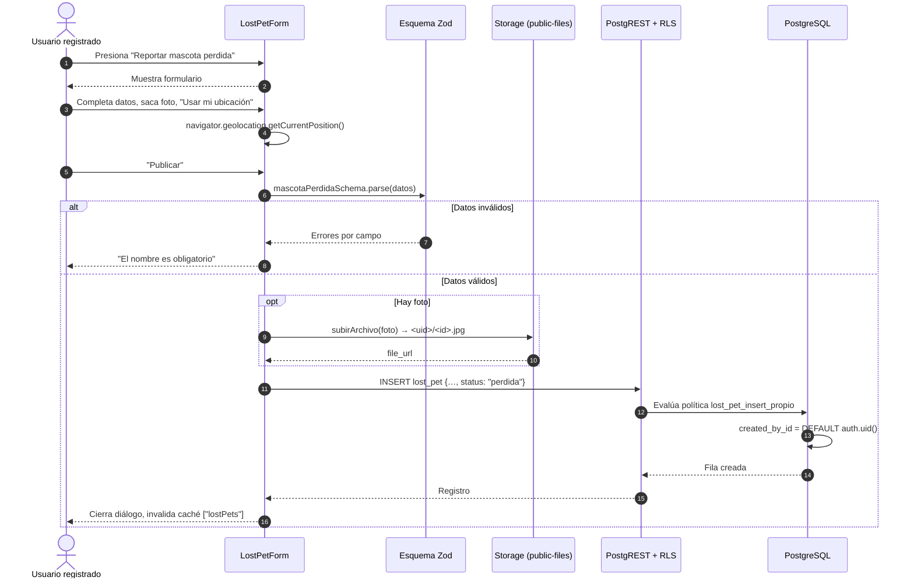

### 4.2 Reportar avistamiento sin cuenta (CU-07, RF-10)

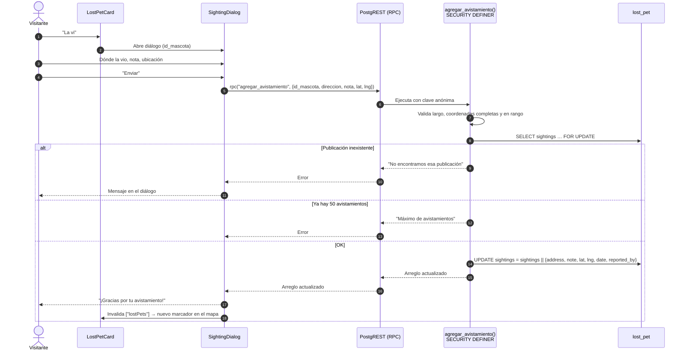

**Por qué una función y no un UPDATE.** La política de `lost_pet` solo deja actualizar al
dueño o a un administrador. Una función `SECURITY DEFINER` hace exactamente una cosa
(agregar un avistamiento) con validaciones propias, sin abrir la tabla entera.

### 4.3 Realizar denuncia con código de seguimiento (CU-16, RF-29, RF-30)

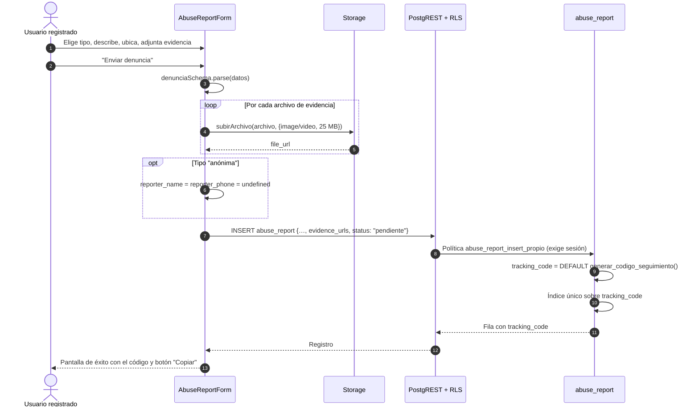

### 4.4 Mensaje de chat y notificación al dueño (CU-22, RF-44)

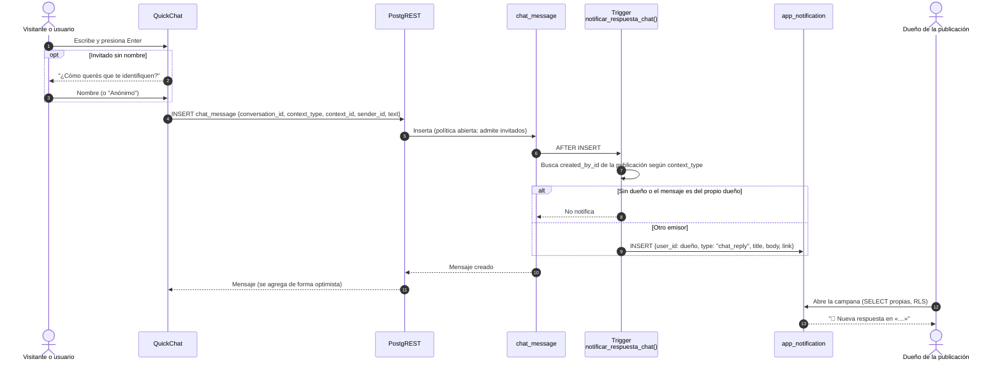

## 5. Diagramas de flujo

### 5.1 Acceso a una pantalla (RF-06, RF-49)

Cómo decide el enrutador qué mostrar. Es el flujo que atraviesa toda la aplicación.

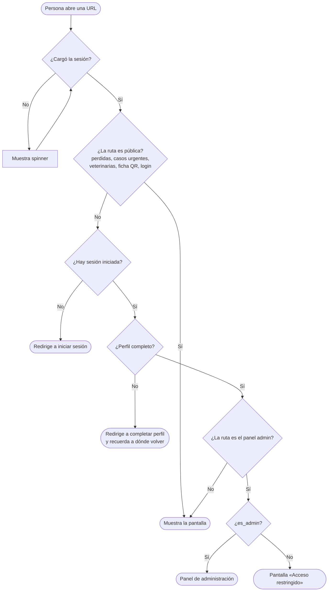

### 5.2 Verificación de una veterinaria (CU-11, CU-13, RN-01)

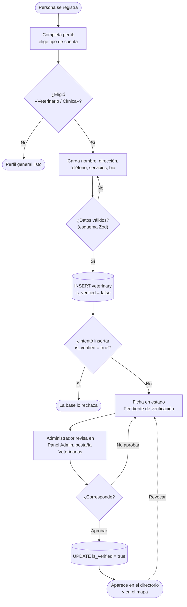

### 5.3 Búsqueda de mascotas perdidas con filtro de cercanía (CU-06, RF-08)

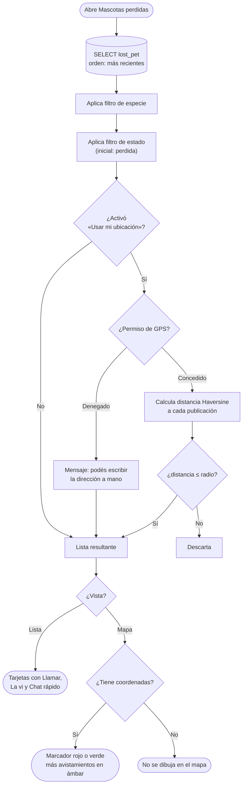

## 6. Diagramas de estados

Ciclo de vida de las publicaciones. Las transiciones indican quién las ejecuta.

### 6.1 Denuncia y caso urgente

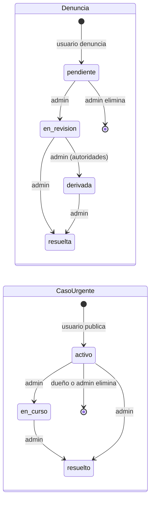

### 6.2 Mascota perdida, adopción y veterinaria

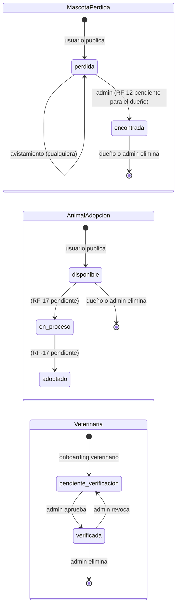

## 7. Trazabilidad

| Diagrama | Casos de uso | Requisitos |
|---|---|---|
| 2 Componentes | Todos | RNF-01, RNF-03, RNF-14 |
| 3.1 Clases: perfil y mascotas | CU-04, CU-05, CU-07, CU-09, CU-14 | RD-01 a RD-04 |
| 3.2 Clases: veterinarias, casos, denuncias | CU-11, CU-13, CU-16, CU-19 | RD-05 a RD-07 |
| 3.3 Clases: comunidad | CU-22, CU-23, CU-24 | RD-08 a RD-10 |
| 4.1 Secuencia: publicar perdida | CU-05 | RF-07, RNF-02, RNF-10 |
| 4.2 Secuencia: avistamiento | CU-07 | RF-10, RN-04 |
| 4.3 Secuencia: denuncia | CU-16 | RF-29, RF-30, RN-02, RN-03 |
| 4.4 Secuencia: chat y notificación | CU-22, CU-24 | RF-42, RF-44 |
| 5.1 Flujo: acceso | CU-02, CU-04 | RF-06, RF-49 |
| 5.2 Flujo: verificación | CU-11, CU-13 | RF-18, RF-22, RN-01 |
| 5.3 Flujo: búsqueda con cercanía | CU-06 | RF-08, RF-09, RNF-11 |
| 6 Estados | CU-13, CU-18, CU-21 | RF-12, RF-17, RF-33, RF-40 |
