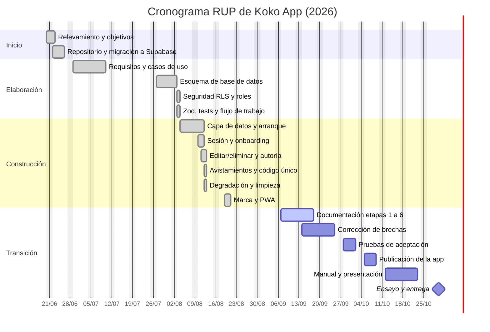

# Etapa 5 — Planificación con RUP

**Proyecto:** Koko App · Conectando Huellas

**Documento:** 5 de 8 · Fases, iteraciones, cronograma, roles y riesgos

---

## 1. Por qué RUP

El Proceso Unificado de Rational (RUP) organiza el proyecto en cuatro fases (Inicio,
Elaboración, Construcción y Transición) que se recorren de forma **iterativa e
incremental**: en cada iteración se hace un poco de cada disciplina (requisitos, análisis
y diseño, implementación, pruebas, despliegue) y al final hay algo que funciona. Se eligió
porque encaja con cómo se dio el proyecto: se partió de un prototipo que ya existía, se
lo reconstruyó por partes y cada parte se probó antes de seguir.

Cada fase termina en un **hito** con un entregable concreto:

| Fase | Hito de cierre | Pregunta que responde |
|---|---|---|
| Inicio | Objetivos del ciclo de vida | ¿Qué problema resolvemos y para quién? |
| Elaboración | Arquitectura estable | ¿Cómo lo vamos a construir y es viable? |
| Construcción | Capacidad operativa inicial | ¿Funciona todo lo prometido? |
| Transición | Entrega del producto | ¿Está documentado, probado y presentado? |

## 2. Equipo y roles

El equipo es de tres personas. En un proyecto chico los roles rotan; la tabla indica la
responsabilidad principal de cada uno, no una exclusividad.

| Integrante | Rol principal | Responsabilidades |
|---|---|---|
| _(completar)_ | Analista y documentación | Requisitos, casos de uso, UML, manual de usuario, presentación. |
| _(completar)_ | Desarrollo frontend | Pantallas, formularios, mapa, chat, PWA. |
| _(completar)_ | Desarrollo backend y base de datos | Esquema, migraciones, políticas RLS, funciones, Supabase. |
| Todos | Pruebas y revisión | Revisar los Pull Requests de los demás, probar en el celular. |

## 3. Fases e iteraciones

Las fechas de Inicio, Elaboración y Construcción son las reales del repositorio (se
tomaron de los commits de GitHub). La fase de Transición está planificada hacia la fecha
de entrega, que se completa en la portada.

### Fase 1 — Inicio (20 al 26 de junio de 2026)

**Objetivo:** acordar el alcance y tener el proyecto en un repositorio compartido.

| Tarea | Disciplina | Resultado |
|---|---|---|
| Relevar el problema con vecinos y rescatistas de Orán; definir usuarios y objetivos. | Requisitos | Etapa 1: análisis del problema. |
| Evaluar el prototipo existente (construido en Base44) y decidir migrar a Supabase. | Análisis y diseño | Decisión de arquitectura: React + Vite + Supabase. |
| Subir el código a GitHub, agregar el SDK de Supabase y documentar cómo correrlo. | Entorno | Repositorio `luanasegobia/koko-app`, README inicial. |
| Eliminar toda dependencia de Base44. | Implementación | Aplicación arrancando contra Supabase. |

**Hito:** objetivos del ciclo de vida aprobados. Esfuerzo: 1 semana.

### Fase 2 — Elaboración (27 de junio al 3 de agosto de 2026)

**Objetivo:** dejar una arquitectura segura y verificable sobre la que construir.

| Iteración | Tareas | Resultado |
|---|---|---|
| E1 | Requisitos funcionales y no funcionales; casos de uso principales. | Etapas 2 y 3 (borradores). |
| E2 | Diseño del esquema de base de datos: 10 tablas, índices, bucket de archivos. Primera migración versionada. | Etapa 6: modelo de datos. |
| E3 | Seguridad: políticas RLS por tabla, función `es_administrador()`, separación de `tipo_cuenta` y `es_admin`, corrección de la recursión en las políticas. | Base cerrada por defecto. |
| E4 | Validación de formularios con Zod, suite de tests con Vitest, integración con Stripe (deshabilitada por bandera). | Calidad automatizable: `npm test`. |
| E5 | Flujo de trabajo del equipo: ramas, Pull Requests, convención de commits en español. | `CONTRIBUTING.md`. |

**Hito:** arquitectura estable (base de datos, autenticación, permisos y flujo de
trabajo definidos). Esfuerzo: 2,5 semanas efectivas.

### Fase 3 — Construcción (4 al 21 de agosto de 2026)

**Objetivo:** que cada módulo funcione de punta a punta en el celular.

| Iteración | Tareas | Resultado |
|---|---|---|
| C1 | Reconstruir la capa de datos heredada (`db.entities`), arranque sin pantallas en blanco, errores de configuración explicados. | Módulos leyendo y escribiendo en Supabase. |
| C2 | Sesión y onboarding sin pisarse; perfil siempre leído desde la tabla `profiles`. | Registro → completar perfil → inicio, estable. |
| C3 | Editar y eliminar lo propio en los seis módulos; autoría asignada por el servidor; `updated_at` automático. | CU-08 completo; políticas de dueño funcionando. |
| C4 | Avistamientos con coordenadas visibles en el mapa; código de seguimiento único generado en la base. | CU-07 y CU-16 completos. |
| C5 | Degradar con elegancia lo que queda fuera de alcance (Stripe, tiempo real, alertas por sondeo). | Banderas de entorno; nada rompe si falta. |
| C6 | Identidad visual: kit de marca en SVG, ícono y manifiesto de PWA, puerto fijo de desarrollo. | Instalable en el celular. |

**Hito:** capacidad operativa inicial (versión beta usable). Esfuerzo: 2,5 semanas
efectivas.

### Fase 4 — Transición (septiembre de 2026 hasta la entrega)

**Objetivo:** cerrar brechas, documentar y presentar.

| Iteración | Tareas | Resultado |
|---|---|---|
| T1 | Documentación académica final: etapas 1 a 6 sobre el sistema real; exportación a PDF. | Carpeta `docs/` completa. |
| T2 | Corregir brechas prioritarias detectadas en la Etapa 2: que el dueño marque su mascota como encontrada (RF-12), cambio de estado de adopción (RF-17), buscador del inicio (RF-13). | Requisitos "parcial" → "implementado". |
| T3 | Pruebas de aceptación con dos o tres personas ajenas al equipo en su celular; corrección de lo que surja. | Lista de hallazgos y ajustes. |
| T4 | Publicar la aplicación (hosting estático + URL real en Supabase Auth), habilitar login con Google si hay tiempo. | URL pública para la demo. |
| T5 | Manual de usuario con capturas, presentación de 15 minutos, ensayo de la demo. | Etapa 8. |

**Hito:** entrega del producto y defensa ante el tribunal.
Esfuerzo estimado: 2 semanas efectivas.

## 4. Cronograma

Los tramos en gris ya están hechos; los de color son la planificación de la Transición.
Los huecos entre fases corresponden a semanas sin actividad (receso de julio y cursada).

> La fecha de entrega (30/10/2026 en el diagrama) es **tentativa**: hay que reemplazarla
> por la que fije la cátedra y correr las tareas de Transición en consecuencia.

### Resumen de esfuerzo

| Fase | Semanas efectivas | Porcentaje |
|---|---|---|
| Inicio | 1 | 12 % |
| Elaboración | 2,5 | 31 % |
| Construcción | 2,5 | 31 % |
| Transición | 2 | 25 % |
| **Total** | **8** | 100 % |

Coincide con las 7 a 8 semanas de trabajo efectivo que propone la guía de la materia; el
calendario real es más largo porque el equipo cursa otras materias en paralelo.

## 5. Artefactos por fase

| Fase | Artefactos RUP | Dónde están |
|---|---|---|
| Inicio | Visión, glosario, lista de riesgos | `docs/01-analisis-del-problema.md`, sección 6 de este documento |
| Elaboración | Especificación de requisitos, modelo de casos de uso, modelo de datos, prototipo de arquitectura | `docs/02-requisitos.md`, `docs/03-casos-de-uso.md`, `docs/06-diseno-base-de-datos.md`, `supabase/migrations/` |
| Construcción | Código, pruebas, modelo de diseño | `src/`, `src/test/`, `docs/04-diagramas-uml.md` |
| Transición | Manual de usuario, material de presentación, producto publicado | `docs/07-manual-de-usuario.md`, `docs/08-presentacion.md` (Etapa 8) |

## 6. Riesgos y mitigación

| # | Riesgo | Probabilidad | Impacto | Mitigación |
|---|---|---|---|---|
| R1 | El proyecto de Supabase del plan gratuito se pausa por inactividad y la demo no arranca. | Alta | Alto | Entrar al panel la semana previa a la defensa y reactivarlo; tener capturas de respaldo en la presentación. |
| R2 | Tres personas escribiendo en la misma base de desarrollo pisan cambios de esquema. | Media | Alto | Una sola persona aplica migraciones y avisa; nunca se edita una migración existente (`CONTRIBUTING.md`). |
| R3 | Funcionalidades prometidas en la interfaz que no están implementadas (solicitudes de adopción, NFC, aviso a municipio) generan preguntas incómodas. | Alta | Medio | Están declaradas como "pendiente" en la Etapa 2; en la presentación se muestran como mejoras futuras. |
| R4 | Permisos de cámara o GPS denegados durante la demo en vivo. | Media | Medio | Todos los flujos funcionan sin GPS ni cámara (RNF-11); ensayar en el dispositivo que se va a usar. |
| R5 | Sin conexión en el aula. | Media | Alto | Compartir datos del celular; video corto de respaldo de la demo. |
| R6 | Cambios de último momento rompen algo que funcionaba. | Media | Alto | Congelar `main` una semana antes; `npm run lint`, `npm test` y `npm run build` obligatorios antes de cada PR. |
| R7 | La clave de servicio de Supabase se filtra en el código. | Baja | Muy alto | La aplicación rechaza esa clave (RNF-03); `.env.local` está en `.gitignore`. |
