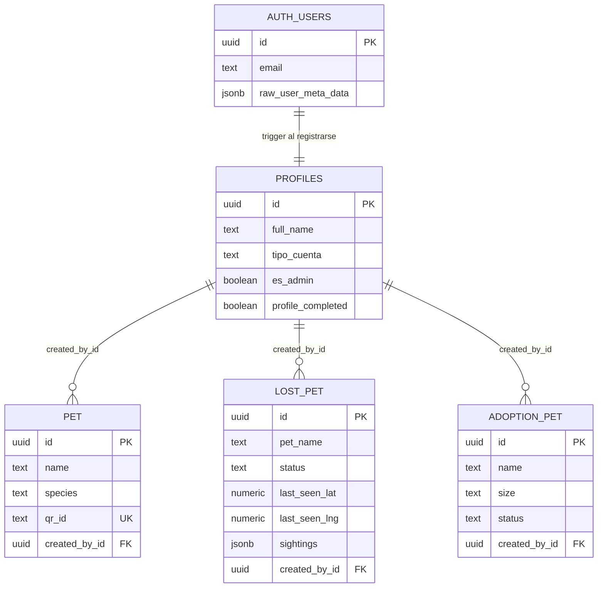
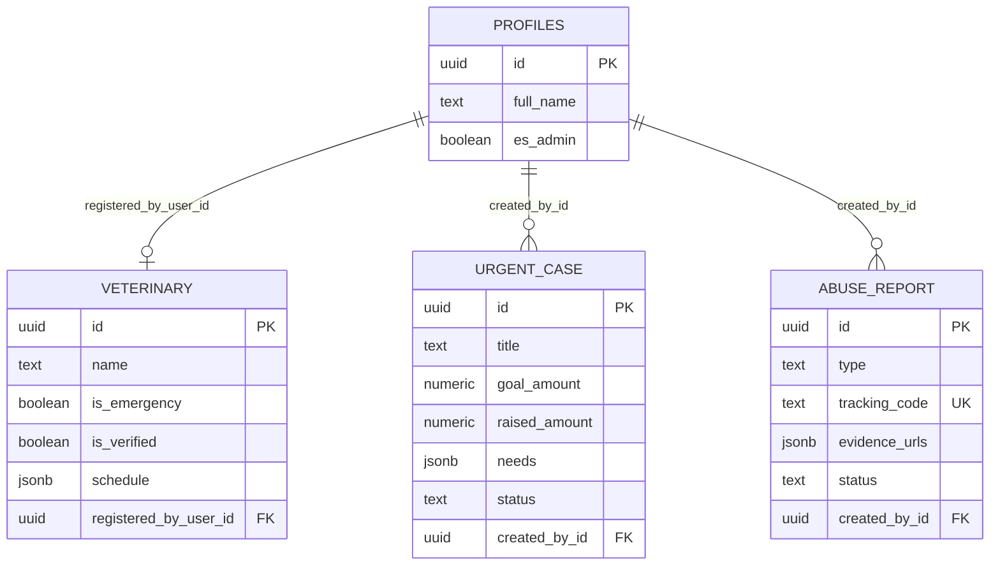
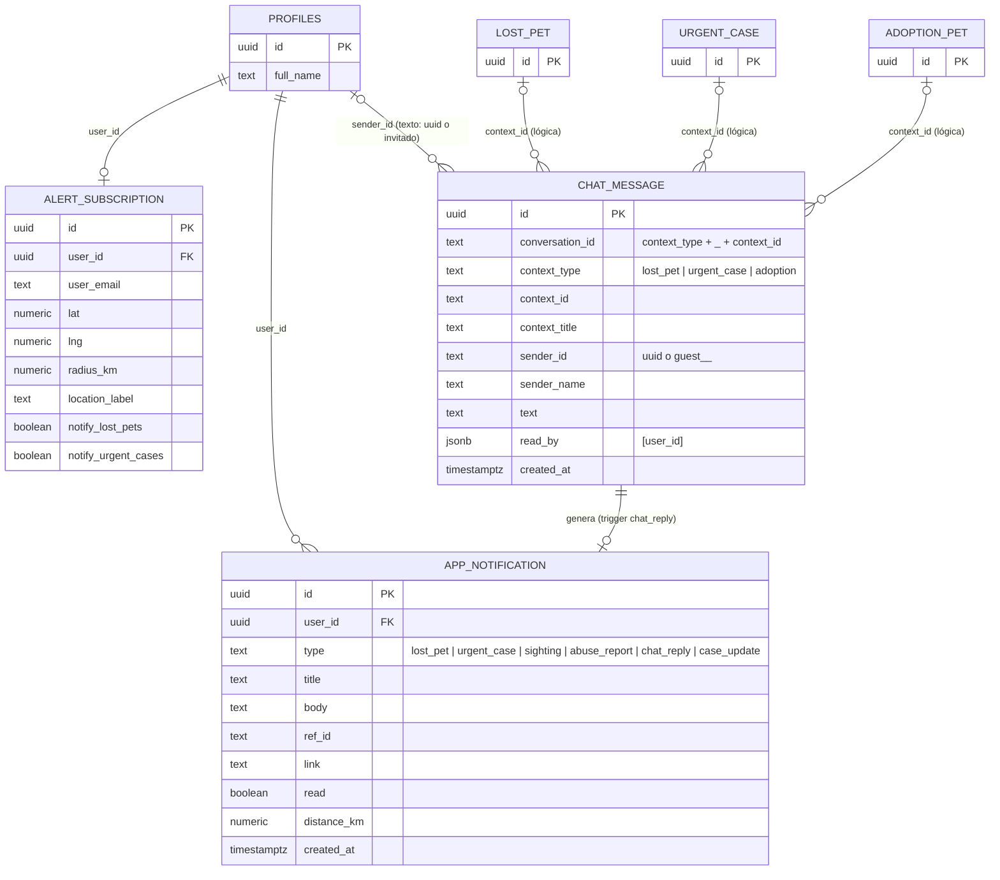

# Etapa 6 — Diseño de base de datos

**Proyecto:** Koko App · Conectando Huellas

**Documento:** 6 de 8 · Modelo entidad-relación, diccionario de datos, seguridad y lógica en la base

---

## 1. Decisiones generales

| Decisión | Motivo |
|---|---|
| **PostgreSQL alojado en Supabase.** | Base relacional madura, sin servidor propio que mantener, con autenticación, almacenamiento de archivos y API REST incluidos. |
| **Claves primarias UUID** (`uuid_generate_v4()`). | Se pueden generar sin coordinación, no revelan cuántos registros hay y sirven en URLs públicas sin exponer secuencias. |
| **Seguridad a nivel de fila (RLS) en todas las tablas.** | La aplicación usa la clave pública desde el navegador; la única barrera real son las políticas de la base. |
| **La autoría la pone el servidor** (`created_by_id DEFAULT auth.uid()`). | Nadie puede publicar a nombre de otra persona aunque manipule la aplicación. |
| **Listas cortas y acotadas guardadas como JSONB** (avistamientos, necesidades, horarios, evidencias, lecturas). | Son datos que siempre se leen junto con su publicación, nunca se consultan sueltos, tienen tope (50 avistamientos, 7 horarios) y evitan tablas y políticas adicionales. Es una desnormalización deliberada; ver sección 4. |
| **Estados como texto con `CHECK`** en lugar de tablas de referencia. | Son pocos valores, fijos, en español, y así el diagrama y el código hablan el mismo idioma. |
| **Marcas de tiempo en todas las tablas** (`created_at`, `updated_at` mantenido por trigger). | Ordenar por fecha y detectar cambios sin lógica en el cliente. |
| **Esquema versionado en migraciones**, una por cambio. | Cualquiera puede reconstruir la base desde cero y el historial explica por qué cambió cada cosa. |

## 2. Modelo entidad-relación

El diagrama muestra las claves y los atributos que definen cada relación; el detalle
completo de columnas está en el diccionario de datos (sección 3). Se presenta en tres
vistas.

### 2.1 Perfiles y mascotas



### 2.2 Veterinarias, casos urgentes y denuncias



### 2.3 Comunidad: chat, notificaciones y alertas



Las relaciones marcadas como **lógicas** no tienen clave foránea en la base: `context_id`
es texto y apunta a una de tres tablas según `context_type`, y `sender_id` admite
invitados sin cuenta. La integridad la garantiza el código y el trigger de
notificación, que resuelve la tabla correcta.

## 3. Diccionario de datos

Tipos según PostgreSQL. **PK** clave primaria, **FK** clave foránea, **UK** única.
Salvo indicación, las columnas admiten `NULL`.

### 3.1 `profiles` — Perfil de usuario (RD-01)

Extiende `auth.users`, la tabla de cuentas que administra Supabase. Se crea sola al
registrarse (trigger `on_auth_user_created`).

| Columna | Tipo | Restricción / valor por defecto | Descripción |
|---|---|---|---|
| id | uuid | PK, FK → auth.users(id) ON DELETE CASCADE | Misma identidad que la cuenta. |
| email | text | | Copiado al registrarse. |
| full_name | text | | Nombre completo. |
| phone | text | | Teléfono o WhatsApp. |
| avatar_url | text | | Foto de perfil. |
| tipo_cuenta | text | NOT NULL, DEFAULT 'usuario', CHECK IN (usuario, rescatista, organizacion, veterinario) | Elegido en el onboarding. Informativo, no otorga permisos. |
| es_admin | boolean | NOT NULL, DEFAULT false | Marca de administración. **No escribible desde la aplicación.** |
| profile_completed | boolean | DEFAULT false | Si terminó el onboarding. |
| bio | text | | Presentación. |
| location | text | | Zona o barrio. |
| organization_name | text | | Solo para tipo `organizacion`. |
| created_at, updated_at | timestamptz | DEFAULT now(); trigger | Marcas de tiempo. |

### 3.2 `pet` — Mascota identificada con QR (RD-02)

| Columna | Tipo | Restricción / valor por defecto | Descripción |
|---|---|---|---|
| id | uuid | PK, DEFAULT uuid_generate_v4() | |
| name | text | NOT NULL | Nombre de la mascota. |
| species | text | NOT NULL, CHECK IN (perro, gato, otro) | |
| breed | text | | Raza. |
| age_years | numeric | | Edad en años. |
| sex | text | CHECK IN (macho, hembra) | |
| photo_url | text | | URL pública en Storage. |
| description | text | | |
| allergies | text | | Se destaca en rojo en la ficha pública. |
| owner_name, owner_phone, owner_whatsapp | text | | Contacto del dueño. |
| qr_id | text | UK | Código de 8 caracteres que va en la URL `/ficha/<qr_id>`. No cambia al editar. |
| created_by_id | uuid | FK → auth.users(id), DEFAULT auth.uid() | Dueño. |
| created_at, updated_at | timestamptz | DEFAULT now(); trigger | |

### 3.3 `lost_pet` — Mascota perdida (RD-03)

| Columna | Tipo | Restricción / valor por defecto | Descripción |
|---|---|---|---|
| id | uuid | PK, DEFAULT uuid_generate_v4() | |
| pet_name | text | NOT NULL | |
| species | text | NOT NULL, CHECK IN (perro, gato, otro) | |
| breed | text | | |
| age_years | numeric | | |
| photo_url | text | | |
| description | text | | |
| last_seen_address | text | | Dirección escrita. |
| last_seen_lat, last_seen_lng | numeric | | Coordenadas; si faltan no aparece en el mapa. |
| contact_phone, contact_whatsapp | text | | |
| status | text | DEFAULT 'perdida', CHECK IN (perdida, encontrada) | |
| sightings | jsonb | DEFAULT '[]' | Lista de avistamientos (sección 4.1). Solo se modifica vía `agregar_avistamiento()`. |
| created_by_id | uuid | FK → auth.users(id), DEFAULT auth.uid() | |
| created_at, updated_at | timestamptz | DEFAULT now(); trigger | |

### 3.4 `adoption_pet` — Animal en adopción (RD-04)

| Columna | Tipo | Restricción / valor por defecto | Descripción |
|---|---|---|---|
| id | uuid | PK, DEFAULT uuid_generate_v4() | |
| name | text | NOT NULL | |
| species | text | NOT NULL, CHECK IN (perro, gato, otro) | |
| breed | text | | |
| age_years | numeric | | |
| sex | text | CHECK IN (macho, hembra) | |
| size | text | CHECK IN (pequeño, mediano, grande) | |
| photo_url | text | | |
| description | text | | |
| vaccinated, sterilized | boolean | DEFAULT false | Estado sanitario. |
| contact_name, contact_phone | text | | |
| location | text | | Barrio. |
| status | text | DEFAULT 'disponible', CHECK IN (disponible, en_proceso, adoptado) | |
| created_by_id | uuid | FK → auth.users(id), DEFAULT auth.uid() | |
| created_at, updated_at | timestamptz | DEFAULT now(); trigger | |

### 3.5 `veterinary` — Veterinaria (RD-05)

| Columna | Tipo | Restricción / valor por defecto | Descripción |
|---|---|---|---|
| id | uuid | PK, DEFAULT uuid_generate_v4() | |
| name | text | NOT NULL | Nombre de la clínica. |
| address | text | NOT NULL | |
| phone | text | NOT NULL | |
| lat, lng | numeric | | Para el mapa. |
| is_emergency | boolean | DEFAULT false | Atiende urgencias 24 h. |
| schedule | jsonb | DEFAULT '[]' | Horarios por día (sección 4.2). |
| services | text | | Texto libre. |
| bio | text | | |
| is_verified | boolean | DEFAULT false | Solo lo cambia administración. |
| registered_by_user_id | uuid | FK → auth.users(id), DEFAULT auth.uid() | Quien la registró. |
| created_at, updated_at | timestamptz | DEFAULT now(); trigger | |

### 3.6 `urgent_case` — Caso urgente (RD-06)

| Columna | Tipo | Restricción / valor por defecto | Descripción |
|---|---|---|---|
| id | uuid | PK, DEFAULT uuid_generate_v4() | |
| title | text | NOT NULL | |
| description | text | NOT NULL | |
| photo_url | text | | |
| published_by | text | | Nombre de quien publica (persona u organización). |
| goal_amount | numeric | DEFAULT 0 | Meta en pesos. |
| raised_amount | numeric | DEFAULT 0 | Recaudado. Lo actualizará el webhook de pagos (pendiente). |
| contributors_count | integer | DEFAULT 0 | Cantidad de colaboradores. |
| donation_alias | text | | Alias bancario. |
| needs | jsonb | DEFAULT '[]' | Necesidades (sección 4.3). |
| status | text | DEFAULT 'activo', CHECK IN (activo, en_curso, resuelto) | |
| created_by_id | uuid | FK → auth.users(id), DEFAULT auth.uid() | |
| created_at, updated_at | timestamptz | DEFAULT now(); trigger | |

### 3.7 `abuse_report` — Denuncia por maltrato (RD-07)

| Columna | Tipo | Restricción / valor por defecto | Descripción |
|---|---|---|---|
| id | uuid | PK, DEFAULT uuid_generate_v4() | |
| type | text | NOT NULL, CHECK IN (urgente, regular, anonima) | |
| description | text | NOT NULL | |
| address | text | | |
| lat, lng | numeric | | |
| evidence_urls | jsonb | DEFAULT '[]' | URLs de fotos y videos en Storage. |
| reporter_name, reporter_phone | text | | Vacíos si la denuncia es anónima. |
| tracking_code | text | UK (índice único), DEFAULT generar_codigo_seguimiento() | 8 caracteres hexadecimales en mayúscula. |
| status | text | DEFAULT 'pendiente', CHECK IN (pendiente, en_revision, derivada, resuelta) | |
| created_by_id | uuid | FK → auth.users(id), DEFAULT auth.uid() | Siempre presente, incluso en anónimas (RN-02). |
| created_at, updated_at | timestamptz | DEFAULT now(); trigger | |

### 3.8 `chat_message` — Mensaje de chat (RD-08)

Inmutable: no tiene `updated_at`.

| Columna | Tipo | Restricción / valor por defecto | Descripción |
|---|---|---|---|
| id | uuid | PK, DEFAULT uuid_generate_v4() | |
| conversation_id | text | NOT NULL | `<context_type>_<context_id>`: una conversación por publicación. |
| context_type | text | NOT NULL, CHECK IN (lost_pet, urgent_case, adoption) | Tabla a la que pertenece la publicación. |
| context_id | text | | Id de la publicación. |
| context_title | text | | Título mostrado en la notificación. |
| sender_id | text | NOT NULL | UUID del usuario o `guest_<nombre>_<marca de tiempo>` para invitados. |
| sender_name | text | | |
| text | text | NOT NULL | |
| read_by | jsonb | DEFAULT '[]' | Ids de quienes lo leyeron. |
| created_at | timestamptz | DEFAULT now() | |

### 3.9 `app_notification` — Notificación (RD-09)

Inmutable salvo la marca `read`.

| Columna | Tipo | Restricción / valor por defecto | Descripción |
|---|---|---|---|
| id | uuid | PK, DEFAULT uuid_generate_v4() | |
| user_id | uuid | NOT NULL, FK → auth.users(id) ON DELETE CASCADE | Destinatario. |
| type | text | NOT NULL, CHECK IN (lost_pet, urgent_case, sighting, abuse_report, chat_reply, case_update) | |
| title | text | NOT NULL | |
| body | text | NOT NULL | |
| ref_id | text | | Id de la publicación relacionada. |
| link | text | | Ruta a la que lleva. |
| read | boolean | DEFAULT false | |
| distance_km | numeric | | Distancia a la publicación, en alertas por zona. |
| created_at | timestamptz | DEFAULT now() | |

### 3.10 `alert_subscription` — Suscripción a alertas (RD-10)

| Columna | Tipo | Restricción / valor por defecto | Descripción |
|---|---|---|---|
| id | uuid | PK, DEFAULT uuid_generate_v4() | |
| user_id | uuid | NOT NULL, FK → auth.users(id) ON DELETE CASCADE | Una por usuario (la aplicación hace upsert). |
| user_email | text | | |
| lat, lng | numeric | | Centro de la zona. |
| radius_km | numeric | DEFAULT 5 | Radio de 1 a 30 km. |
| location_label | text | | Etiqueta ("Mi casa"). |
| notify_lost_pets | boolean | DEFAULT true | |
| notify_urgent_cases | boolean | DEFAULT true | |
| created_at, updated_at | timestamptz | DEFAULT now(); trigger | |

### 3.11 Almacenamiento de archivos (RD-11)

Bucket **`public-files`**, público para lectura por URL. Los archivos se guardan bajo la
carpeta del usuario (`<user_id>/<id único>.<extensión>`) para que la política de borrado
pueda identificar al propietario. Límite en el cliente: 8 MB para fotos, 25 MB para
evidencia de denuncias (imágenes y videos).

## 4. Estructuras JSONB

### 4.1 `lost_pet.sightings` — Avistamiento

```json
{
  "address": "Plaza San Martín, frente a la iglesia",
  "note": "Tenía collar rojo, estaba asustado",
  "lat": -23.1372,
  "lng": -64.3281,
  "date": "2026-08-12T15:40:00Z",
  "reported_by": "uuid del usuario o null si fue sin cuenta"
}
```

Reglas (aplicadas por `agregar_avistamiento()`): `address` obligatorio y de hasta 200
caracteres; `note` hasta 500; `lat` y `lng` vienen juntas o ninguna; máximo 50 por
publicación.

### 4.2 `veterinary.schedule` — Horario de atención

```json
{ "day": "lunes", "open": "08:00", "close": "20:00" }
```

Un elemento por día en español (`domingo` … `sábado`). Con él la aplicación calcula
"De turno", "Cerrada" y "Abre <día> HH:MM". Pendiente: pantalla para cargarlo (RF-21).

### 4.3 `urgent_case.needs` — Necesidad

```json
{ "label": "Cirugía de cadera", "status": "pendiente" }
```

`status` ∈ `pendiente | parcial | cubierto`. Pendiente: poder cambiarlo desde la
interfaz (RF-41).

### 4.4 Otros

- `abuse_report.evidence_urls`: arreglo de URLs públicas de Storage.
- `chat_message.read_by`: arreglo de ids de usuario que leyeron el mensaje.

## 5. Índices

| Tabla | Índice | Columnas | Para qué |
|---|---|---|---|
| lost_pet | idx_lost_pet_status | status | Filtro perdida/encontrada. |
| lost_pet | idx_lost_pet_species | species | Filtro por especie. |
| lost_pet | idx_lost_pet_created | created_at DESC | Orden "más recientes". |
| lost_pet | idx_lost_pet_created_by | created_by_id | Políticas de dueño. |
| adoption_pet | idx_adoption_pet_status, idx_adoption_pet_species, idx_adoption_pet_created_by | status / species / created_by_id | Filtros y políticas. |
| pet | idx_pet_created_by | created_by_id | "Mis mascotas" y políticas. |
| veterinary | idx_veterinary_verified | is_verified | Directorio público. |
| veterinary | idx_veterinary_registrada_por | registered_by_user_id | Políticas de dueño. |
| urgent_case | idx_urgent_case_status, idx_urgent_case_created_by | status / created_by_id | Filtros y políticas. |
| abuse_report | idx_abuse_report_status, idx_abuse_report_created_by | status / created_by_id | Moderación y políticas. |
| abuse_report | idx_abuse_report_tracking_code_unico (**único**) | tracking_code | Búsqueda por código y unicidad. |
| chat_message | idx_chat_message_conversation | conversation_id | Cargar una conversación. |
| chat_message | idx_chat_message_created | created_at DESC | Orden cronológico. |
| app_notification | idx_app_notification_user | user_id, created_at DESC | Campana de notificaciones. |
| alert_subscription | idx_alert_subscription_user | user_id | Suscripción propia. |

## 6. Funciones y triggers

| Objeto | Tipo | Qué hace |
|---|---|---|
| `handle_new_user()` + trigger `on_auth_user_created` (AFTER INSERT en auth.users) | Función SECURITY DEFINER | Crea la fila de `profiles` con email, nombre y avatar de los metadatos del registro. Si falla, deja un aviso en el registro del servidor pero **no cancela la creación de la cuenta**. |
| `tocar_updated_at()` + 8 triggers `on_<tabla>_updated` (BEFORE UPDATE) | Función de trigger | Mantiene `updated_at = now()` en profiles, pet, lost_pet, adoption_pet, veterinary, urgent_case, abuse_report y alert_subscription. |
| `es_administrador()` | Función SQL SECURITY DEFINER, STABLE | Devuelve si el usuario autenticado tiene `es_admin = true`. La usan todas las políticas; ser DEFINER evita la recursión infinita que se producía al consultar `profiles` desde una política de `profiles`. |
| `preservar_es_admin()` + trigger `on_profile_admin_update` (BEFORE UPDATE en profiles) | Función de trigger | Si un rol que no es de sistema intenta pasar `es_admin` de true a false, lo revierte. Segunda barrera además de los permisos por columna. |
| `agregar_avistamiento(id_mascota, direccion, nota, lat, lng)` | Función plpgsql SECURITY DEFINER, ejecutable por `anon` y `authenticated` | Valida y agrega un avistamiento al arreglo `sightings` de una publicación ajena. Bloquea la fila (`FOR UPDATE`) para evitar carreras. |
| `generar_codigo_seguimiento()` | Función SQL VOLATILE | `upper(substr(md5(gen_random_uuid()::text), 1, 8))`. Valor por defecto de `abuse_report.tracking_code`. |
| `notificar_respuesta_chat()` + trigger `on_chat_message_created` (AFTER INSERT en chat_message) | Función SECURITY DEFINER | Busca al dueño de la publicación según `context_type` y le inserta una notificación `chat_reply`, salvo que el mensaje sea suyo. |

Además de los permisos por tabla, sobre `profiles` hay **permisos por columna**: los roles
`anon` y `authenticated` solo pueden insertar y actualizar las columnas del perfil, nunca
`es_admin`.

## 7. Políticas de seguridad (RLS)

Resumen de quién puede hacer qué. "Dueño" es quien tiene su id en `created_by_id`
(o `registered_by_user_id` / `user_id` / `sender_id`); "Admin" es `es_administrador()`.

| Tabla | SELECT | INSERT | UPDATE | DELETE |
|---|---|---|---|---|
| profiles | Propio o admin | Propio, sin `es_admin` | Propio, sin `es_admin` | — |
| pet | **Todos** | Con sesión, como propio | Dueño o admin | Dueño o admin |
| lost_pet | Todos | Con sesión, como propio | Dueño o admin (avistamientos vía función) | Dueño o admin |
| adoption_pet | Todos | Con sesión, como propio | Dueño o admin | Dueño o admin |
| veterinary | Verificadas, la propia, o todas si admin | Con sesión, como propia, **sin verificar** | Dueño o admin | **Solo admin** |
| urgent_case | Todos | Con sesión, como propio | Dueño o admin | Dueño o admin |
| abuse_report | Todos | Con sesión, como propio | Dueño o admin | **Solo admin** |
| chat_message | Todos | **Todos** (admite invitados) | Emisor o admin | Emisor o admin |
| app_notification | Propias o admin | Solo propias (las de chat las crea el trigger) | Propias o admin | Solo admin |
| alert_subscription | Propia o admin | Propia | Propia | Propia |
| storage.objects (public-files) | Listar solo lo propio (leer por URL es público) | Con sesión | Con sesión | Propietario |

**Observación documentada:** la lectura de `pet` es pública para que la ficha QR funcione
sin sesión; la pantalla "Mis mascotas" filtra por dueño en el cliente. Una mejora futura
es exponer la ficha pública a través de una vista o función que devuelva solo los campos
necesarios (RNF-07 parcial).

## 8. Cómo reconstruir la base

El "script SQL" del proyecto es la carpeta `supabase/migrations/`, con un archivo por
cambio y en orden cronológico:

| Migración | Contenido |
|---|---|
| `20260803215353_esquema_inicial` | Las 10 tablas, índices, bucket, políticas iniciales y alta automática de perfil. |
| `20260803224544_endurecer_seguridad` | search_path fijo, notificaciones solo propias + trigger de chat, veterinarias sin autoverificarse, listado de Storage restringido. |
| `20260803231642_proteger_rol_perfil` | Permisos por columna sobre `profiles`. |
| `20260803232319_corregir_recursion_rls` | Función de administración SECURITY DEFINER para evitar la recursión de políticas. |
| `20260803233027_perfil_onboarding` | Columnas bio, location, organization_name; roles en español. |
| `20260803233240` y `20260803233312_preservar_rol_admin*` | Trigger que impide degradar a un administrador. |
| `20260803234227_separar_tipo_cuenta_y_admin` | `tipo_cuenta` + `es_admin` reemplazan a `role`; todas las políticas repuntadas. |
| `20260812045503_autoria_y_marcas_de_tiempo` | Autoría por DEFAULT, políticas de inserción propias, `updated_at`, avistamientos por función, código de seguimiento único. |
| `20260812104806_avistamientos_con_coordenadas` | Avistamientos con lat/lng validadas. |

Para aplicarlas a un proyecto nuevo de Supabase:

```bash
supabase link --project-ref <ref-del-proyecto>
```

```bash
supabase db push
```

Alternativamente, pegar los archivos en orden en el SQL Editor del panel de Supabase:
todas las migraciones son re-ejecutables (usan `IF NOT EXISTS` y `DROP … IF EXISTS`).
