# Manual de usuario

**Proyecto:** Koko App · Conectando Huellas

**Documento:** 7 de 8 · Guía paso a paso para usar la aplicación

---

## 1. Qué es Koko

Koko es una aplicación web comunitaria para las mascotas de Orán. Desde el celular o la
computadora podés publicar una mascota perdida y verla en el mapa, avisar que viste una,
ofrecer o buscar animales en adopción, consultar qué veterinaria está de turno, crear una
chapa con código QR para tu mascota, hacer una denuncia por maltrato y colaborar con casos
urgentes.

**Qué necesitás:** un celular o una computadora con navegador (Chrome, Edge, Firefox o
Safari) y conexión a internet. No hace falta instalar nada.

**Instalarla como aplicación (opcional).** Al abrirla desde el celular, el navegador ofrece
"Agregar a la pantalla de inicio" o "Instalar aplicación". Así queda con su ícono, como
cualquier otra app.

### Qué se puede hacer sin cuenta

| Sin cuenta | Con cuenta |
|---|---|
| Ver mascotas perdidas, casos urgentes y veterinarias | Publicar mascotas perdidas, adopciones, casos urgentes y denuncias |
| Avisar que viste una mascota perdida | Registrar tus mascotas y obtener su QR |
| Ver la ficha de una mascota escaneando su QR | Chatear en la ventana de adopciones |
| Participar en el chat rápido con un nombre | Recibir alertas de tu zona y notificaciones |
| Consultar una denuncia con su código | Editar y eliminar lo que publicaste |

---

## 2. Primeros pasos

### 2.1 Crear una cuenta

1. Abrí la aplicación y tocá **Registrate**.
2. Completá nombre completo, email y una contraseña de al menos 6 caracteres, dos veces.
3. Tocá **Crear cuenta**. Te llega un email con un **código de 6 dígitos**.
4. Escribí el código en la pantalla de verificación y tocá **Verificar**. Si no llegó,
   revisá la carpeta de spam o tocá **Reenviar**.

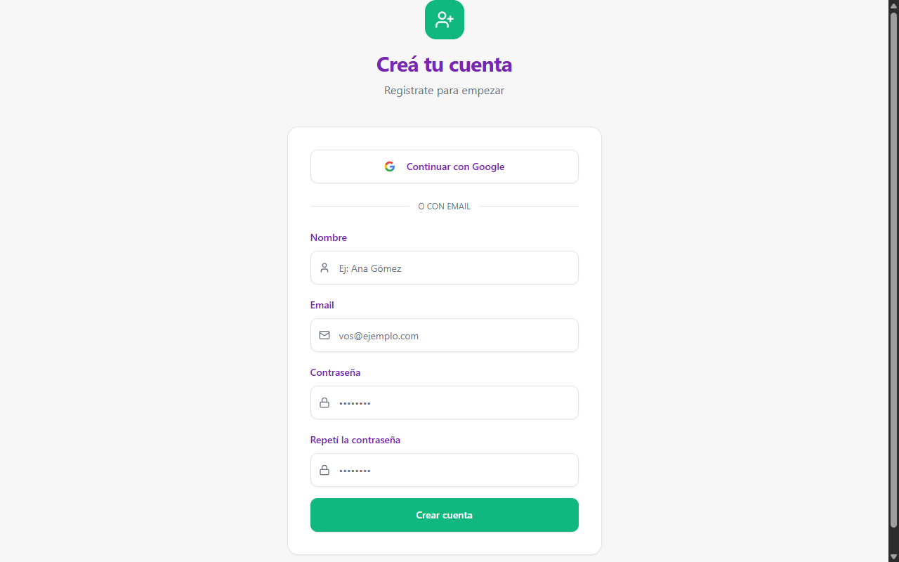

### 2.2 Iniciar sesión

1. Ingresá tu email y contraseña y tocá **Ingresar**.
2. Si olvidaste la contraseña, tocá **¿Olvidaste tu contraseña?**, escribí tu email y
   seguí el enlace que te llega por correo para elegir una nueva.

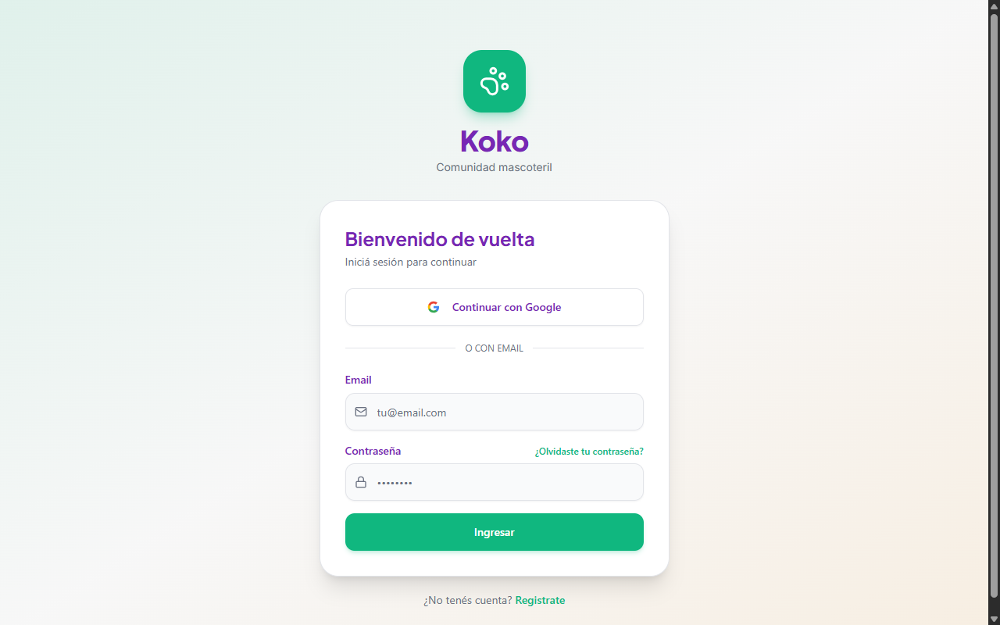

> El botón **Continuar con Google** todavía no está habilitado. Usá email y contraseña.

### 2.3 Completar el perfil

La primera vez que entrás, la aplicación te pide elegir qué tipo de cuenta sos:

- **Usuario común:** querés adoptar, reportar mascotas perdidas o colaborar.
- **Rescatista / Organización:** rescatás animales o representás una ONG.
- **Veterinario / Clínica:** querés aparecer en el directorio de veterinarias. Vas a
  cargar los datos de la clínica y un administrador la revisa antes de publicarla.

Después completás teléfono, zona y una breve descripción, y tocás **Comenzar**.

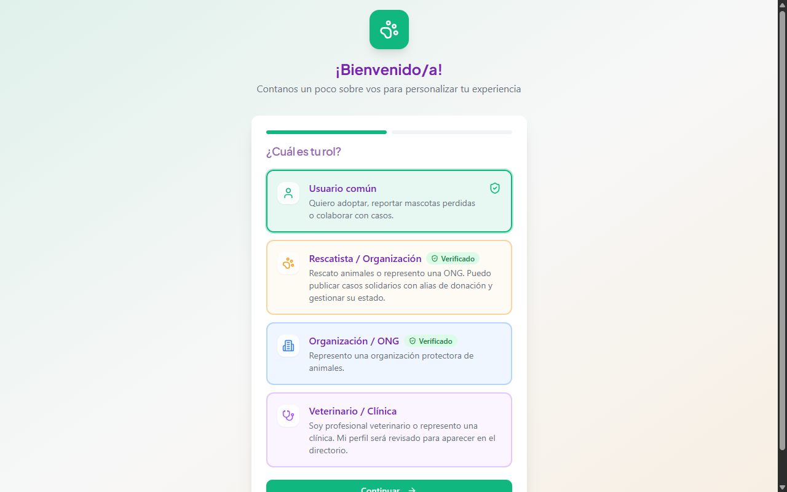

### 2.4 Cerrar sesión, modo claro y oscuro

En el menú lateral (o en la barra inferior del celular) están **Modo claro / Modo
oscuro** y **Cerrar sesión**.

---

## 3. Pantalla de inicio

Muestra los accesos a los seis módulos, los botones rápidos **Perdí mi mascota** y
**Encontré un animal**, y el acceso a las alertas de tu zona.

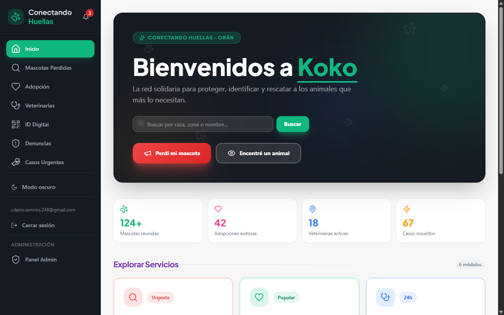

---

## 4. Mascotas perdidas

### 4.1 Buscar una mascota perdida

1. Entrá a **Mascotas Perdidas**.
2. Elegí la vista **Lista** o **Mapa**.
3. Filtrá por especie (perros, gatos, otros) y por estado (perdidas, encontradas).
4. Para ver solo las cercanas, tocá **Usar mi ubicación** en *Filtrar por proximidad* y
   ajustá el radio (de 0,5 a 20 km). Si tu celular pide permiso de ubicación, aceptalo.

En el mapa, los marcadores rojos son mascotas perdidas, los verdes las encontradas y los
ámbar los avistamientos. Tocá un marcador para ver la foto, los datos y el botón para
llamar.

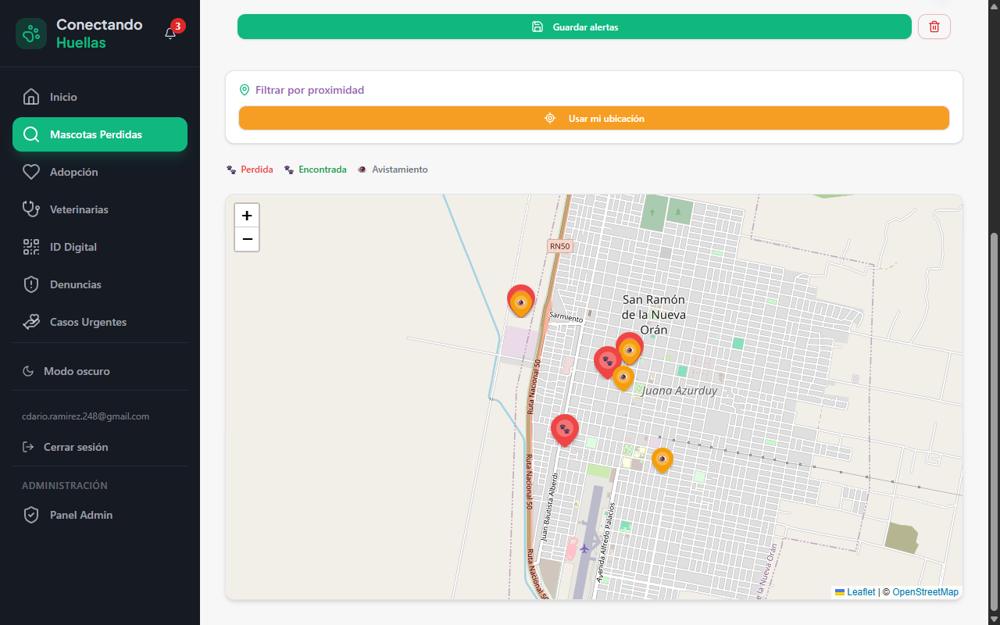

### 4.2 Publicar una mascota perdida

1. Tocá **Reportar mascota perdida** (necesitás haber iniciado sesión).
2. Completá el nombre (obligatorio), la especie y, si podés, raza, edad y una descripción
   con señas particulares.
3. Tocá **Sacar foto** para usar la cámara o elegir una imagen.
4. Escribí dónde la viste por última vez y tocá **Usar mi ubicación** para marcarla en
   el mapa.
5. Cargá un teléfono y WhatsApp de contacto y tocá **Publicar**.

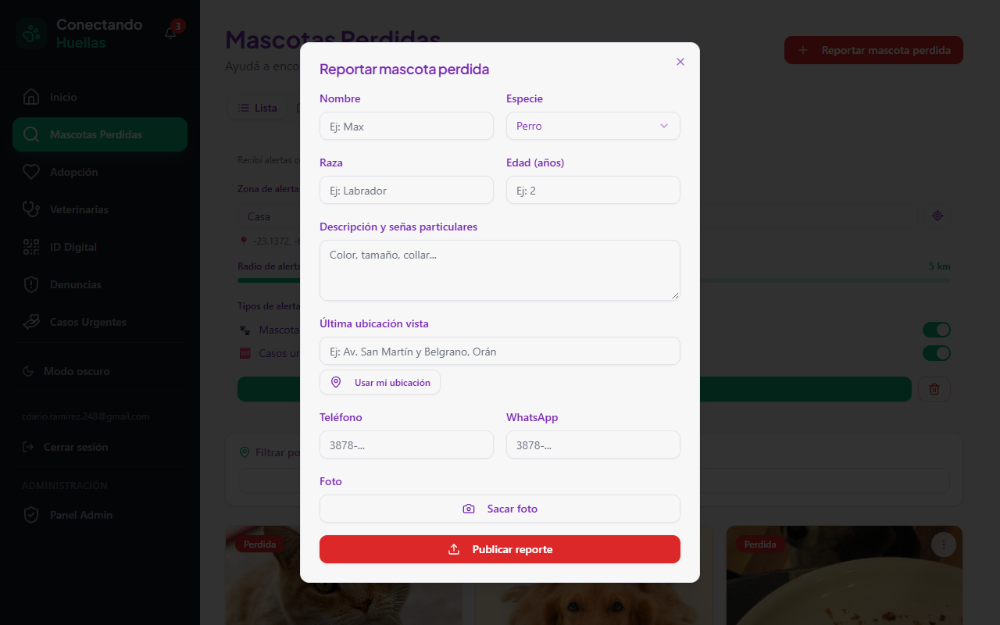

> Si negás el permiso de ubicación, la publicación se crea igual con la dirección
> escrita, pero no aparece en el mapa.

### 4.3 Avisar que viste una mascota ("La vi")

Cualquier persona puede avisar, **sin cuenta**.

1. En la tarjeta de la mascota, tocá **La vi**.
2. Escribí dónde la viste (obligatorio) y, si querés, una nota.
3. Tocá **Usar mi ubicación** para que el aviso aparezca en el mapa.
4. Tocá **Enviar**. El dueño ve el avistamiento en su publicación.

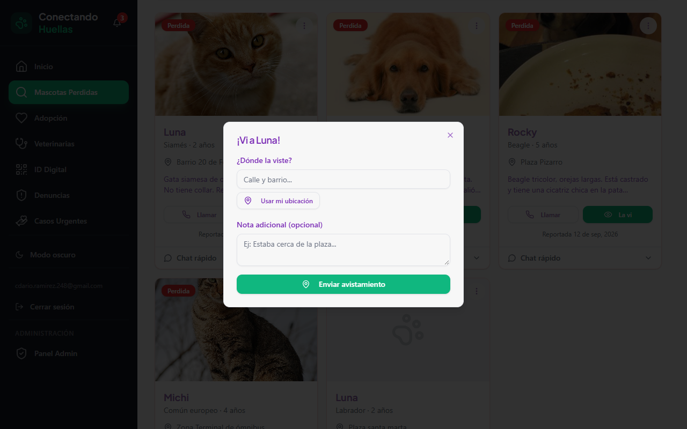

### 4.4 Chat rápido

Cada publicación tiene un **Chat rápido** para aportar información. Si no tenés cuenta, la
primera vez te pide un nombre. El dueño recibe una notificación con cada respuesta.

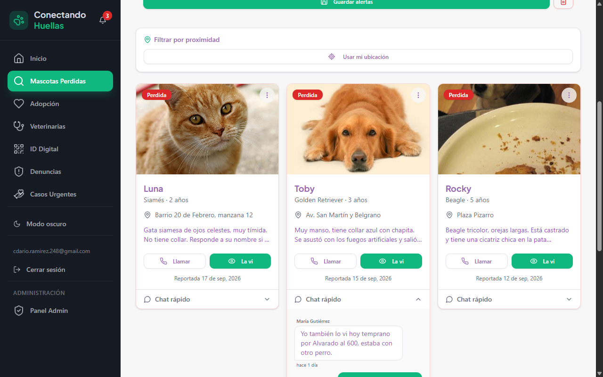

### 4.5 Editar o eliminar tu publicación

En tus propias publicaciones aparece el menú **⋯** con **Editar** y **Eliminar**. Eliminar
pide confirmación y no se puede deshacer.

> Marcar la mascota como *encontrada* lo hace hoy el equipo de administración: avisá por
> el chat o escribí a los administradores.

---

## 5. Adopción

### 5.1 Buscar un animal para adoptar

1. Entrá a **Adopción** (requiere cuenta).
2. Filtrá por especie y tamaño.
3. Cada tarjeta muestra sexo, si está vacunado y esterilizado, y el barrio.
4. Tocá **Contactar** para llamar o **Chat** para escribirle a quien lo publicó.

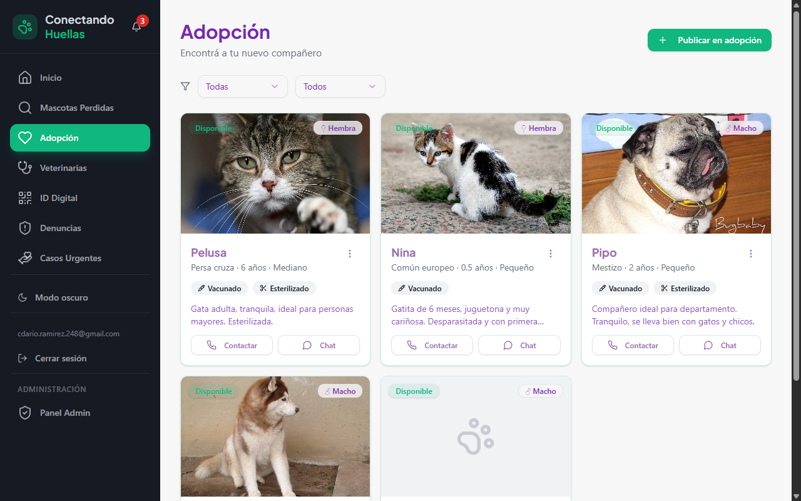

### 5.2 Publicar un animal en adopción

1. Tocá **Publicar en adopción**.
2. Completá nombre, especie, sexo, tamaño y descripción; marcá si está vacunado y
   esterilizado.
3. Agregá una foto, tu nombre, teléfono y barrio, y tocá **Publicar**.

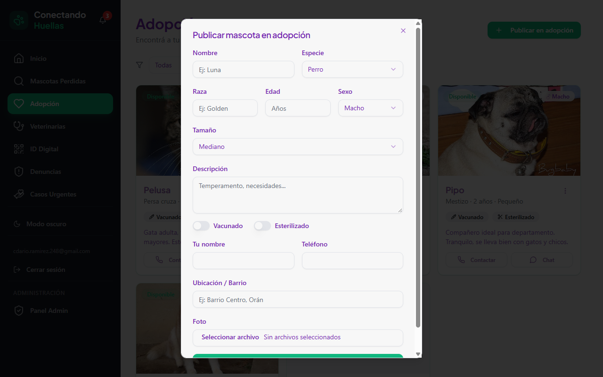

---

## 6. Veterinarias

1. Entrá a **Veterinarias**. No hace falta cuenta.
2. Arriba ves cuántas atienden **Emergencia 24h**, cuántas están **De turno ahora** y
   cuántas **Cerradas**. Las de emergencia aparecen primero.
3. Cada ficha indica si está abierta, a qué hora abre y qué servicios ofrece. Tocá
   **Llamar** para llamar directamente.
4. En la vista **Mapa** las ves ubicadas.

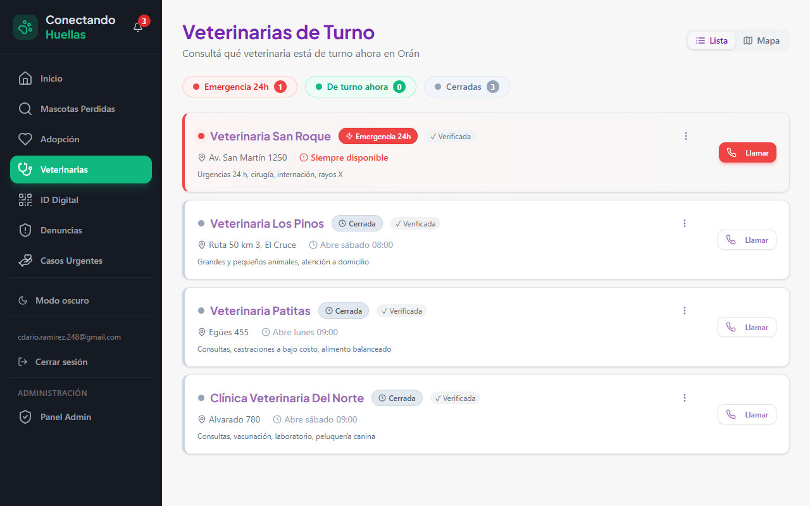

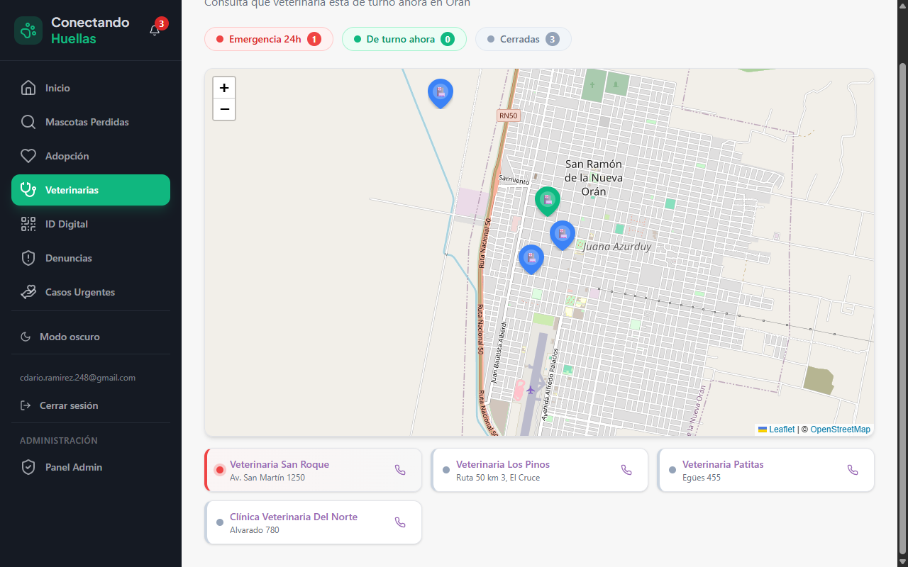

> Solo aparecen veterinarias verificadas por el equipo. Si sos veterinario, registrá tu
> clínica al completar el perfil (sección 2.3) y esperá la verificación.

---

## 7. Identificación digital (chapa con QR)

### 7.1 Registrar tu mascota

1. Entrá a **ID Digital** (requiere cuenta) y tocá **Registrar mascota**.
2. Completá nombre, especie, sexo, raza, edad, descripción y **alergias** (importante:
   se muestran en rojo a quien la encuentre).
3. Cargá tu nombre, teléfono y WhatsApp, y una foto. Tocá **Guardar**.

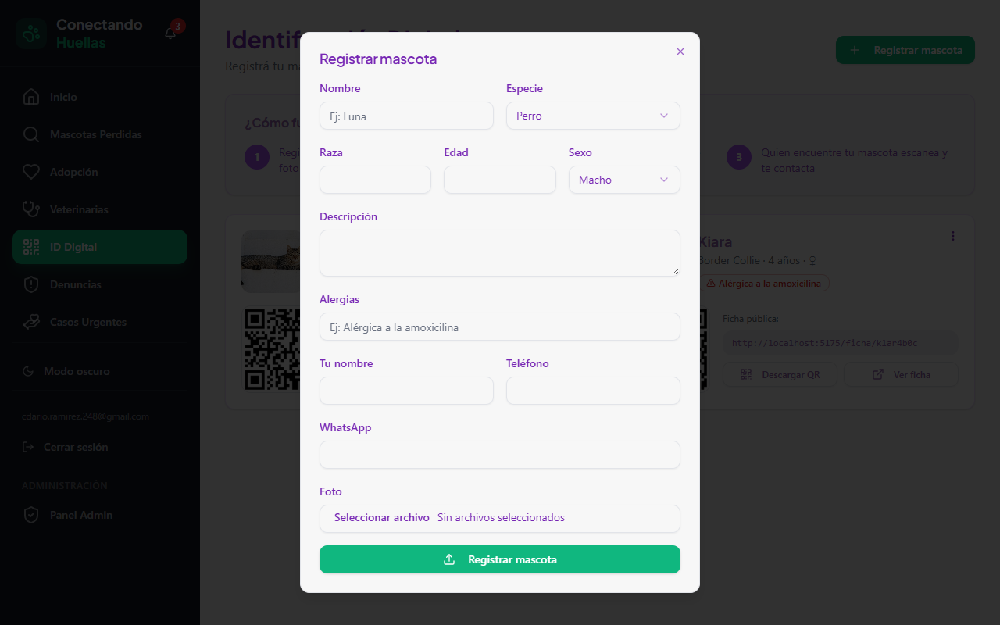

### 7.2 Descargar e imprimir el QR

Cada mascota tiene su tarjeta con el código QR. Tocá **Descargar QR** para guardar la
imagen e imprimirla en una chapa, un collar o una etiqueta. **Ver ficha** abre lo que va a
ver quien la escanee.

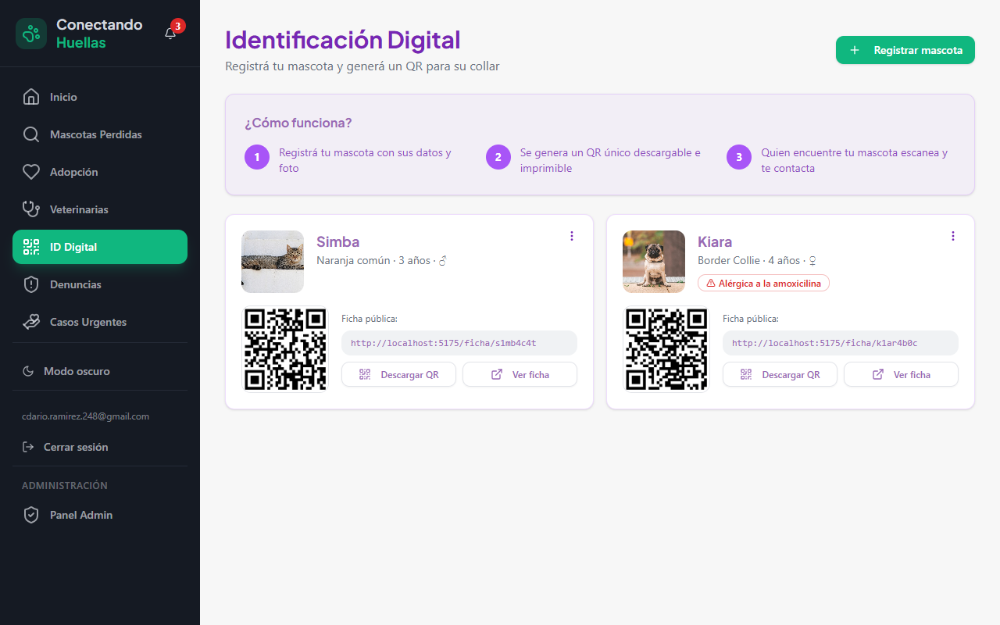

### 7.3 Qué ve quien encuentra a tu mascota

Al escanear el QR con la cámara del celular se abre la ficha pública, sin necesidad de
cuenta: alergias destacadas, foto, datos y botones para **Llamar** o escribir por
**WhatsApp**.

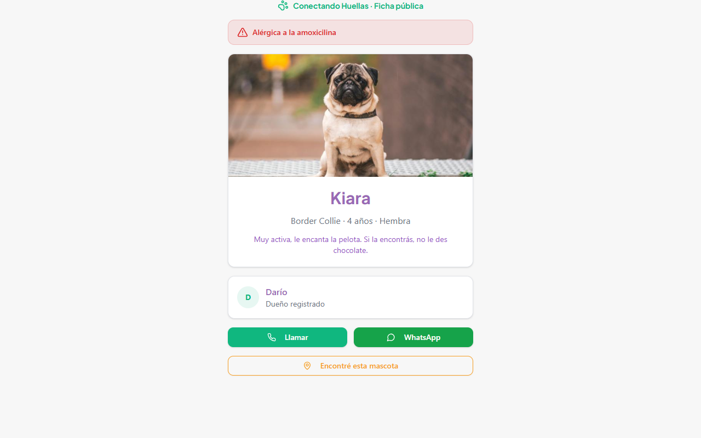

> Si editás los datos de tu mascota, el código QR no cambia: las chapas ya impresas siguen
> sirviendo.

---

## 8. Denuncias por maltrato

### 8.1 Hacer una denuncia

1. Entrá a **Denuncias** (requiere cuenta) y tocá **Reportar**.
2. Elegí el tipo: **Urgente**, **Regular** o **Anónima** (en la anónima no se guardan tu
   nombre ni tu teléfono).
3. Describí la situación (obligatorio), escribí la dirección y tocá **Usar mi ubicación**.
4. Adjuntá fotos o videos como evidencia (hasta 25 MB cada archivo).
5. Tocá **Enviar denuncia**. La pantalla te muestra un **código de seguimiento**: copialo
   y guardalo.

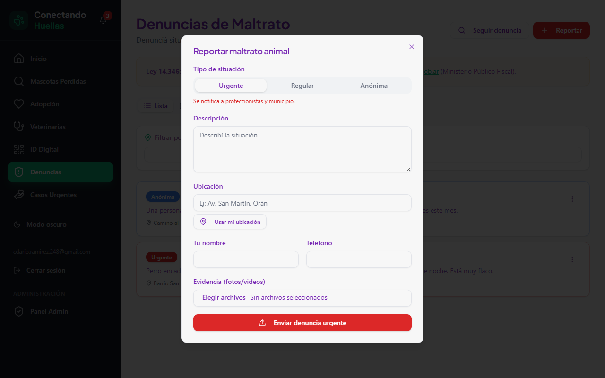

### 8.2 Consultar el estado de una denuncia

1. Tocá **Seguir denuncia** e ingresá el código.
2. Vas a ver el estado actual: *pendiente*, *en revisión*, *derivada* o *resuelta*.

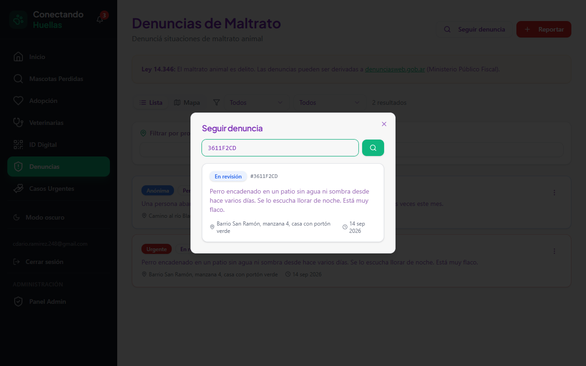

### 8.3 Ver las denuncias de la zona

La lista y el mapa muestran las denuncias con filtros por tipo, estado y cercanía. La
pantalla incluye el marco legal (Ley 14.346) y el enlace al canal oficial de denuncias.

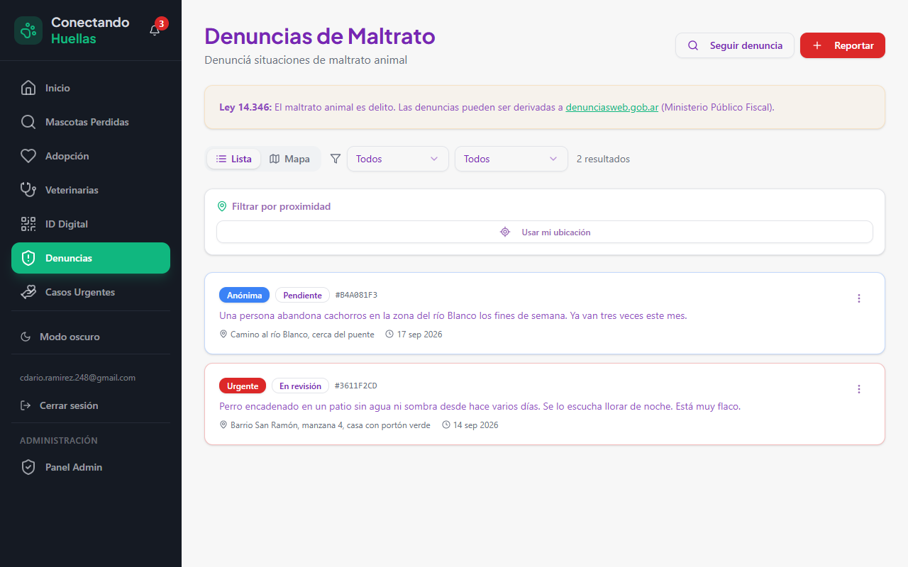

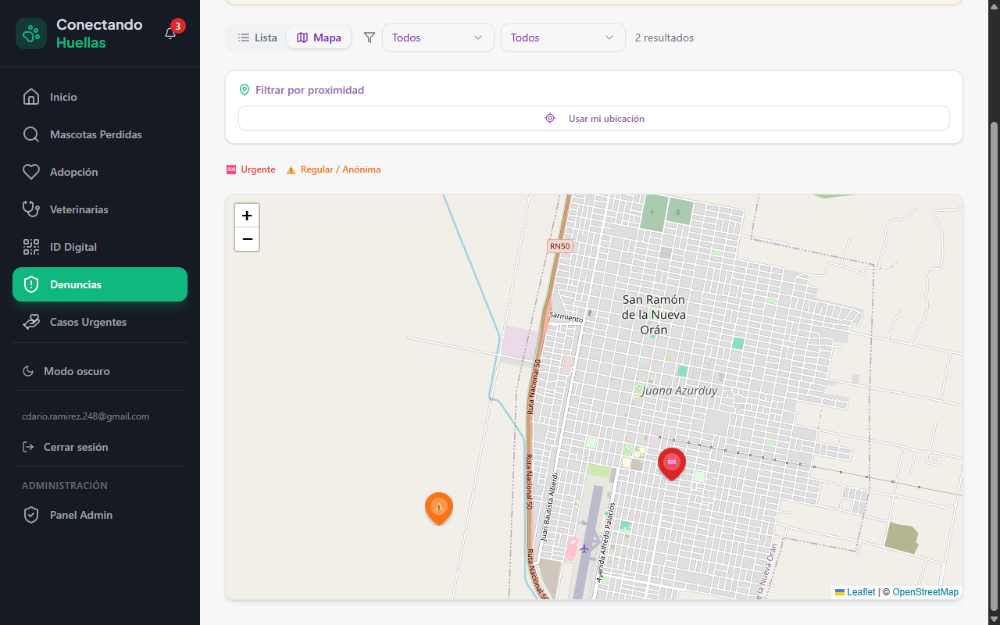

> Una denuncia no se puede borrar por quien la hizo, para no perder la evidencia. Solo el
> equipo de administración puede eliminarla.

---

## 9. Casos urgentes y donaciones

### 9.1 Colaborar con un caso

1. Entrá a **Casos Urgentes**. No hace falta cuenta para ver y donar.
2. Cada caso muestra cuánto se recaudó respecto de la meta y qué necesidades faltan
   (✕ pendiente, ◑ parcial, ✓ cubierta).
3. Tocá **Copiar** junto al alias y hacé la transferencia desde tu banco o billetera.
4. Podés dejar información en el **Chat rápido**.

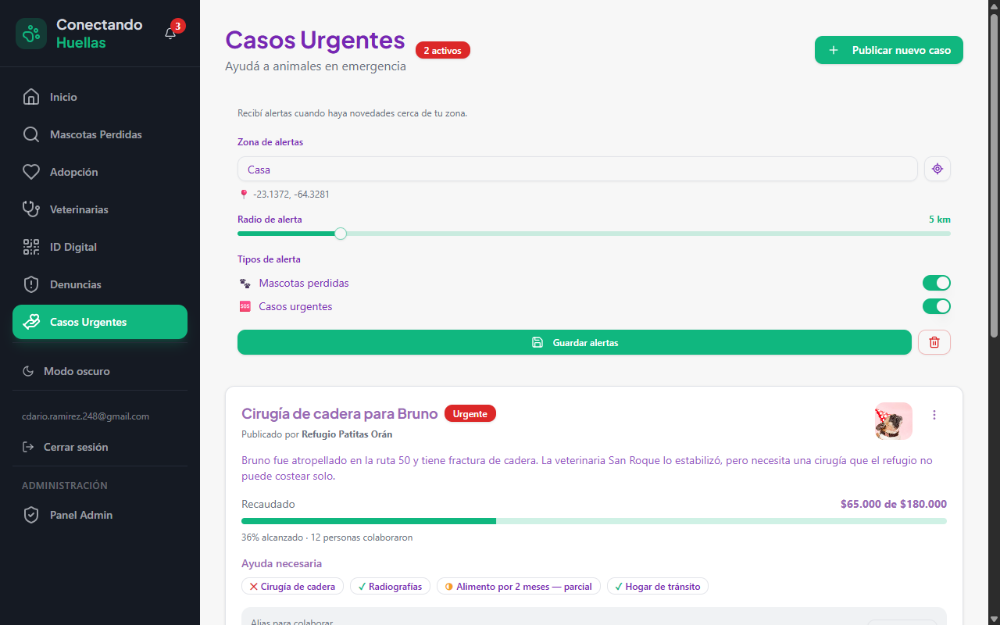

> **Donar con tarjeta** aparece deshabilitado: el pago con tarjeta se habilita en una
> próxima versión.

### 9.2 Publicar un caso urgente

1. Tocá **Publicar nuevo caso** (requiere cuenta).
2. Completá título y descripción (obligatorios), quién publica, la meta en pesos y el
   alias para donar.
3. Agregá las necesidades una por una con **+ Agregar**, una foto, y tocá **Publicar**.

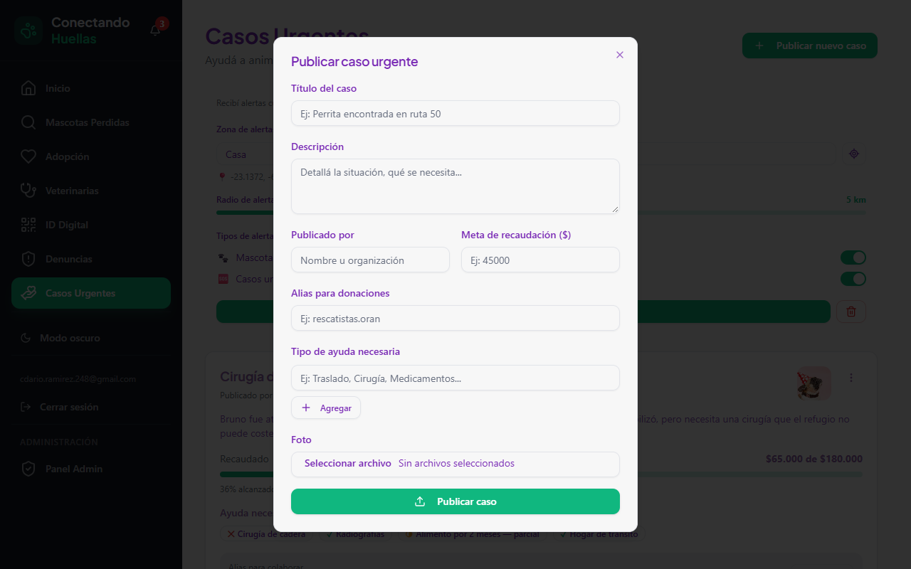

---

## 10. Notificaciones y alertas de tu zona

### 10.1 Campana de notificaciones

La campana muestra cuántas notificaciones tenés sin leer: respuestas en tus chats y
mascotas perdidas cerca. Tocá una para marcarla como leída o **Todo leído**.

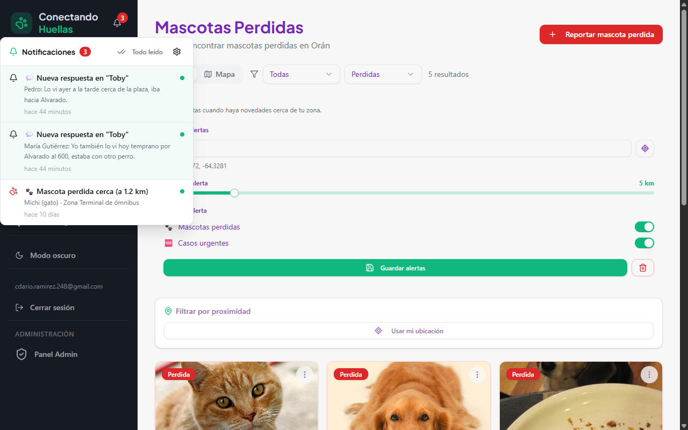

### 10.2 Activar las alertas de tu zona

1. En **Mascotas Perdidas** o **Casos Urgentes**, buscá *Recibí alertas de tu zona*.
2. Tocá el botón de ubicación para marcar tu casa y elegí el radio (de 1 a 30 km).
3. Activá los avisos que quieras (mascotas perdidas, casos urgentes) y tocá **Guardar
   alertas**. Si el navegador pregunta, permití las notificaciones.

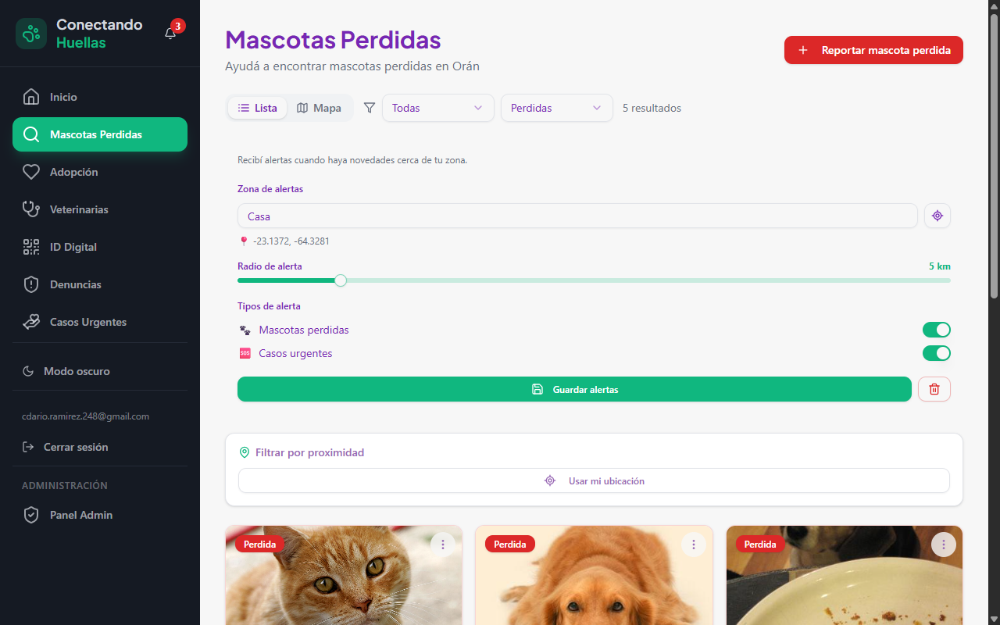

---

## 11. Panel de administración

Solo lo ven las cuentas con permiso de administración (aparece **Panel Admin** en el menú).

- **Estadísticas:** totales de perdidas y encontradas, adopciones, casos por estado,
  denuncias por estado y veterinarias verificadas y pendientes.
- **Veterinarias:** pestañas *Pendientes* y *Verificadas*. **Aprobar** publica la
  veterinaria en el directorio; **Revocar** la saca.
- **Casos & Reportes:** cambiar el estado de casos urgentes (activo, en curso,
  resuelto), mascotas perdidas (perdida, encontrada) y denuncias (pendiente, en revisión,
  derivada, resuelta), y ver la evidencia adjunta de cada denuncia.

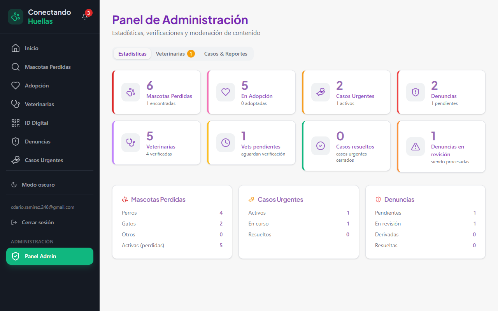

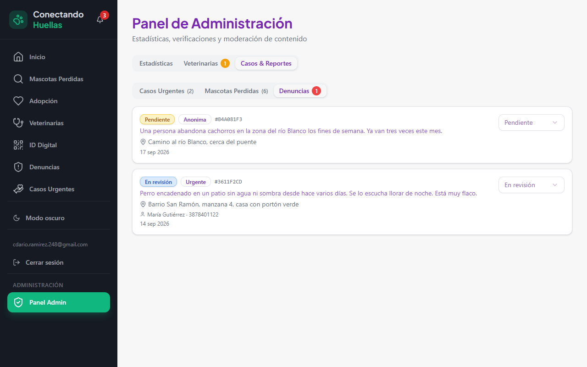

> El permiso de administración no se otorga desde la aplicación: lo asigna el equipo
> técnico directamente en la base de datos.

---

## 12. Problemas frecuentes

| Problema | Qué hacer |
|---|---|
| No me llega el código de verificación. | Revisá spam y tocá **Reenviar**. Verificá que el email esté bien escrito. |
| "Continuar con Google" da error. | Todavía no está habilitado. Ingresá con email y contraseña. |
| El botón **Usar mi ubicación** dice que no tiene permiso. | Podés escribir la dirección a mano. Para habilitarlo: configuración del navegador → permisos del sitio → Ubicación. |
| La foto no se sube. | Tiene que ser una imagen de hasta 8 MB (evidencia de denuncias: hasta 25 MB, imagen o video). |
| No veo el botón **Editar** en una publicación. | Solo aparece en las publicaciones que creaste vos. |
| Aparece "No tenés permiso para hacer esto". | La acción es de otra persona o de administración. Cerrá sesión y volvé a entrar si acabás de recibir un permiso nuevo. |
| Los mensajes del chat no aparecen solos. | En esta versión hay que volver a abrir la conversación para ver respuestas nuevas. |
| La app muestra "Falta configurar el proyecto". | Es un aviso para el equipo técnico: faltan las claves de conexión. |
